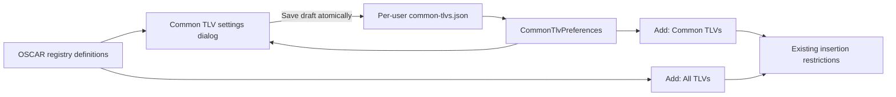
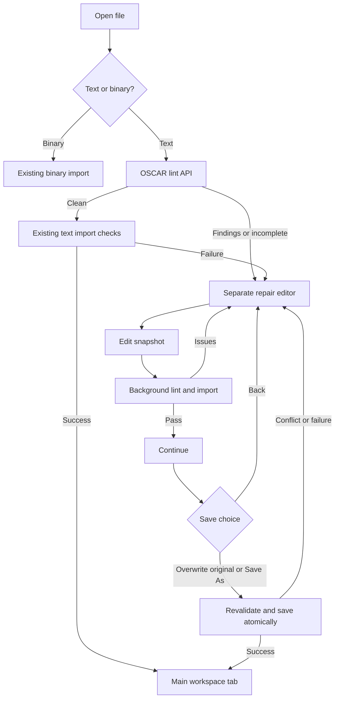

# OSCAR-UI architecture

[Development guide](../README.md) · [Verification checklist](../testing/checklist.md) · [Deferred work](../todo/TODO.md)

This document describes the current implementation. Optional configuration
checks are incomplete; successful encoding is not deployment validation.

## UI component ownership

`MainWindow` arranges panes, owns actions and document state, and coordinates
asynchronous service operations. Widgets and their callbacks run on the Qt UI
thread. Oscar parsing, validation, and serialization remain in the service layer.

| Component | Responsibility |
| --- | --- |
| `ConfigurationTreePane` | Tree rows, TLV-to-row mapping, parent lookup, selection, MIC visibility, and context menus |
| `ConfigurationTextPane` | Read-only source preview and selection highlighting, including CRLF position conversion |
| `TlvEditorDialog` | Shared Add/Edit controls, value help, validation, and delete confirmation |
| `NewDocumentDialog` | New configuration and reference-template choices |
| `GlobalSettingsDialog` | Persisted appearance choice and session MIC visibility |
| `SecretsDialog` / `CustomSnmpRulesPane` | Session shared secret, SNMP masking, and custom object rules |
| `SaveFormatDialog` | Text/Binary choice; the main window performs the save |
| `BinaryInspectionDialog` | Read-only, monospace HexDump and top-level TLV listings |
| `BinaryCheckDialog` | Optional draft configuration-check results |
| `TlvHexDialog` | Selected instance and nested TLV hex rows with descriptions |
| `AboutDialog` | Build-derived package versions, links, and manual update checks |
| `SharedSecretCheckDialog` / `SharedSecretField` | Independent MIC verification and momentary secret reveal |
| `TlvDescriptionFormatter` | Presentation-only description reflow |

Panes keep their internal maps private and expose domain operations. The tree
emits normal Qt selection signals; the main window connects them to text
highlighting and action availability. Context menus reuse the main window's
actions so permissions and shortcuts have one owner.

Qt parent ownership manages child widgets. Temporary dialogs and context menus
are disposed after use. Stable widget object names remain available to UI tests.
Small labels, standard file dialogs, and message boxes stay with their owner;
they do not require separate classes.

Parsed TLV instances use descriptive `Node` components (`tlvPath`, `tlvName`,
`encodedValueText`, `childTlvs`, and `isContainer`). Source ranges use UTF-16
offsets with an exclusive end; `terminatorOffset` identifies a closing brace
or semicolon. These editing instances remain separate from Oscar's registry
definitions. Catalog lookup uses an extensible `RegistryFamily` key, while
the UI's editable-codec allowlist deliberately supports fewer codecs than Oscar.

Follow [coding-style](../../../skills/coding-style/SKILL.md) when adding or changing
components. Run the service tests and the native Qt tests described in the
[development guide](../README.md) after moving UI responsibilities.

## Document and service boundaries

`OscarDocumentService` owns immutable source snapshots, source spans, registry
lookup, transactional edits, and text saves. `OscarBinaryService` owns content
detection, binary import/export, and immutable saved-byte snapshots.
`BinaryTreeProjection` maps OSCAR-compiled instances back to source occurrences.
The main window submits document work to its worker and applies completed
results together on the Qt thread; closing stops polling and cancels pending work.
No widget maintains a separate DOCSIS parser, registry, or encoder.

The workspace is a horizontal splitter with **Configuration | TLV | Value**
on the left and read-only source text on the right. Dotted TLV paths identify
registry definitions; instance/source identity distinguishes repeated entries.
Selecting a row highlights its source span. The main caption is **OSCAR-UI**;
file type and optional **Masked** status appear at bottom right, without paths.

## Catalogs and new documents

Use OSCAR's bundled DOCSIS, DOCSIS 4.0, DPoE, and PacketCable registries through
its parser/resolver and `TlvRegistry` APIs. Do not merge catalogs, infer headers
from filenames, or copy definitions into the UI. Codec-based controls use
structured metadata; descriptions are not enums, defaults, or protocol rules.
New codecs or families may require upstream and adapter work.
OSCAR owns the SNMP symbol LUT in its JAR; the UI does not maintain a copy.
Its runtime may create the ignored `res/DottedTextualNetSNMPMap.json` cache.
Indexed-symbol limitations remain in [TODO](../todo/TODO.md#vacm-and-snmpv3-symbolic-configuration).

New requires an explicit supported type and offers Empty or All TLVs.
All TLVs calls `ConfigurationFileExport.EXPORT_DEFAULT_TLV` on the worker and
retains a reference-template marker for reopening unmapped placeholders as
read-only entries. The adapter substitutes the selected supported PacketCable
header for the exporter's placeholder header; the body remains upstream output.
Recognized valueless entries such as `NetworkAccess;` are editing placeholders:
OSCAR validates the name but assigns no value and emits no corresponding binary
TLV. Explicit values such as `NetworkAccess 0;` remain real values. An explicitly
quoted empty string is subject to datatype/length rules, not this placeholder
rule. Unknown names are not made valid by omitting their values. The UI delegates
encoding to OSCAR rather than stripping entries or inventing defaults itself.
A required placeholder does not satisfy complete-file minimum checks; successful
text parsing or saving a draft does not guarantee binary compilation will succeed.

Empty drafts and templates are unsaved and do not establish valid deployment
values. Successful New/Open offers Add TLV once; cancellation and generation
failure preserve the previous document. Queue Add directly from successful
load completion rather than a separate zero-delay callback that can race later
operations. Cancelling Add preserves the new draft.

## Automatic open and safe saving

Open reads a bounded snapshot (1 MiB) and detects content rather than extensions.
Recognized UTF-8 text uses its declared header and must pass the text compilation
check below. A failed recognized text compilation does not fall back to binary.
Binary compatibility candidates are Docsis, Docsis-4.0, DPoE, then PacketCable
1.0/1.5/2.0. Accept only a complete import whose re-encoded ordered TLV payloads
match the original. Unknown, truncated, unsupported, or lossy inputs fail without
replacing the active document. Shared encodings choose the first compatible
profile; this does not prove a device's exact DOCSIS edition.

Text retains original source/path/hash. Binary retains decoded text plus an
immutable origin path/hash/byte snapshot, with no active text path. Open is
unmodified and does not ask for a shared secret or verify MICs. Text compilation
is unsigned validation; it does not sign or write a deployment binary.

Save uses the active format and destination; new drafts ask for a text path.
Save As chooses Text/Binary and destination. Only a successful write changes the
active format/path, clears modified, and completes pending tab-close/Exit actions.
Text saves preserve formatting without implicit signing. Binary saves compile
original values through OSCAR with the session shared secret when required,
validate the decoded/re-encoded payloads before replacement, and refresh the
saved bytes/hash and generated MIC display. Masking never changes export values.

Writes use temporary-file replacement and external-change hashes. Save As
confirms overwrite against the observed destination hash. Text cannot overwrite
its imported binary origin or aliases; binary cannot overwrite the active text
source or aliases. Binary Save can replace its own origin. Cancellation, missing
secrets, encoder errors, and write failures preserve document and destination.
Save/Discard/Cancel protects replacement and exit while modified.

Check Config is an optional draft preview, not a gate on Binary Save. OSCAR
enforces required top-level settings during DOCSIS finalization: NetworkAccess,
UpstreamServiceFlow and DownstreamServiceFlow for the UI-supported editions.
Incomplete drafts can still be edited and saved as text. Failed binary exports
preserve existing destinations. Broader dependency checks and interoperability
remain unfinished;
future requirements are tracked in [TODO](../todo/TODO.md#configuration-validation).

## TLV editing transactions

Add/Edit/Del operate on exact source instances, reparse the proposed result,
and refresh both panes together. Stale selections, invalid values, cancellation,
and failures preserve the document. Unchanged Apply is a no-op. Edits do not
write files; they preserve surrounding comments, line endings, repeated entries,
and disk/origin protection. Cut/Paste and direct text editing are unavailable.

Add obtains the complete parent catalog through `addDefinitions`; `choices`
remains the insertion-authorized subset. Both share `insertionIssue` so displayed
restrictions and insert-time enforcement agree. Common TLVs uses per-user
`CommonTlvPreferences` with minimum-only defaults; All TLVs includes every parent definition.
Child containers show all definitions in either mode. Unavailable rows are disabled
with a Status explanation, including generated fields and instance limits.
The searchable chooser has **TLV | Name | Status** columns, with TLV/Name sorting: numeric component
order for dotted paths, alphabetical name order, both reversible. Sorting and
search preserve the selected definition and entered value. Help shows a data
type and example/range. Description formatting reflows prose into paragraphs
of at most two sentences while preserving lists and aligned technical examples.

Adding a Parent TLV scaffolds only its immediate registry children as blank
placeholders; nested parents remain empty until explicitly populated through
Add or double-click. Selection/expansion alone never mutates data. Removing the
last child leaves the parent's empty `Name;` form, without automatic refill.
Unsupported placeholders may be removable while remaining noneditable;
unmapped/protected entries and deferred DOCSIS 4.0 scope retain their restrictions.

Double-clicking a scalar prefills the current value, including unsaved edits.
Parent TLVs have no editable scalar. Delete from the editor/menu confirms the
selected instance and all descendants, with Cancel as the safe default, then
selects the surviving parent and frees the instance slot. Duplicate copies an
eligible top-level TLV and its entire source subtree immediately after it,
respecting instance limits/protected entries and selecting the copy. Copied
identifiers may need user edits. Compound SNMP edits are described below.

Generated CM/CMTS MIC entries are hidden in the tree by default. Settings →
Global can reveal them for the session; they remain read-only and unavailable
for Add/Delete. The filter applies to the applicable top-level MIC definitions,
not unrelated nested or PacketCable entries. Source text and export are unchanged.

## TLV editor terminology

Add and Edit dialogs label a TLV that contains child TLVs as **Parent TLV**,
using the help text **Parent TLV | Add values to its child TLVs**. Use this
user-facing term instead of **Container**. Values are entered on the child
TLVs; the parent does not expose an editable scalar value. Internal container
identifiers and Oscar APIs retain their existing names.

## Binary inspection

Inspect follows Settings in the menu bar. The menu itself and its HexDump and
TLV breakdown actions are enabled
only when idle with an active binary document (`path == null`, `origin != null`).
Opening text or saving as text disables both even if the document retains a
binary origin for overwrite protection. New text drafts also disable inspection. Hovering over the disabled Inspect
menu explains that a binary file must be selected. The menu-bar action is
explicitly disabled, and mouse tracking supplies the hint even for disabled
actions; while busy, it asks the user
to wait for the current operation.

`OscarBinaryService` renders the immutable bytes from the last open/binary save
on the existing worker. It does not reread disk, encode edits, sign data, or log
contents. The dialog labels this snapshot and excludes unsaved edits.
HexDump requires acknowledgment on every open that original bytes can expose
community strings and other secrets in clear text. Cancel is the default; no
listing is generated or displayed until Yes is selected. After acknowledgment,
HexDump uses Oscar `HexDump.dumpHexString` without masking, regardless of the
masking preference. The preference and other masked views remain unchanged. TLV breakdown matches Oscar's
`--hex toplevel` type-labelled rows, but reuses the existing length-aware payload
walker (`TlvDictionary.getTopLevelByteLength`, `TlvBuilder.nextTLVIndex`) and
`HexString` formatting: Oscar 3.1.2 `TlvBuilder.tlvDump` assumes one-byte lengths.
Rows preserve top-level instance order and nested bytes; padding/end markers
appear only in HexDump. This is not a recursive decoded TLV tree.

## Keyboard shortcuts

Use Qt standard key bindings, with one action owning each shortcut. File → Save
owns Ctrl+S directly and displays it in the menu. It saves the active format:
text to its text path, binary to its binary path, and a new text document through
the destination chooser. Saving is disabled while busy or without changes.

| Action | Windows / Linux shortcut | Behavior |
| --- | --- | --- |
| New | Ctrl+N | Create a document, with an unsaved-change prompt if needed |
| Open | Ctrl+O | Open a text or binary configuration |
| Save | Ctrl+S | Save in the current format |
| Save As | Ctrl+Shift+S | Choose Text or Binary, then a destination |
| Copy | Ctrl+C | Copy selected configuration text |
| Select All | Ctrl+A | Select all configuration text |
| Quit | Qt platform default | Close with an unsaved-change prompt; window close shortcuts also apply |

Qt resolves platform-specific standard bindings; macOS generally uses Command
instead of Control, but native macOS UI support is not verified. Copy and Select
All also follow the focused text widget's behavior in dialogs.

## System appearance and JSON preferences

`Appearance` has SYSTEM (default), LIGHT, and DARK choices. `DesktopTheme`
resolves SYSTEM using Qt 6.8
[`QStyleHints.colorScheme`](https://doc.qt.io/qt-6.8/qstylehints.html#colorScheme-prop); an unknown system scheme
falls back to Light. A queued `colorSchemeChanged` connection reapplies the chosen
palette after Qt processes the system change. Explicit Light/Dark choices remain
fixed. The connection is disconnected when the window closes. Icons follow the
resolved palette. OS notification delivery depends on the desktop/Qt platform.

`AppearanceSettingsStore` owns only the per-user JSON schema and file I/O.
`MainWindow` locates `settings.json` through `QStandardPaths.AppConfigLocation`,
loads it before displaying the window, and saves on Settings → Global → OK.
Cancel never writes. Successful persistence precedes applying the choice; write
failure reports an error and keeps the previous settings. Missing files default
to System; malformed/unreadable files produce a visible status message and are
not overwritten at startup. Saves use a sibling temporary file and atomic rename
where available, with replacement fallback on filesystems without atomic moves.

```json
{
  "version": 1,
  "appearance": "system",
  "obfuscateSnmpSecrets": false
}
```

Appearance and the masking checkbox are persisted: no shared secret, community values, configuration
contents, or MIC visibility. Settings are outside the installation directory and
survive uninstall. Noninteractive smoke/tests skip user settings unless a test
injects a temporary settings store.

## About and release checks

The About panel displays a read-only **TLV Registry | Specification** panel beside
the package/version and release-update panels. A two-column layout reduces
dialog height; license/report links and Close remain below both columns. Both use grouped
label layouts with bold headings and content-sized height, without table
selection, header bars, or a fixed-height empty area. File types and
edition text come from `OscarDocumentService.types()` and the bundled OSCAR
catalogs, without a second UI specification list. Multi-source editions separated
by ` + ` render on separate lines in one cell; the complete source text remains
available as a tooltip. Missing registry discovery shows an explicit unavailable
row while retaining package versions and update controls. This is file-type
provenance, not a compliance statement or a list of all embedded catalogs.


`AboutDialog` owns the branded About panel, project links, build versions, and
manual update status. A Package | Version | Link grid lists OSCAR-UI and OSCAR
with clickable GitHub links. The OSCAR-UI license links to the
repository’s `LICENSE` file on GitHub. Maven filters `build-info.properties` from the project,
Oscar, and Qt Jambi versions so packaged and development builds report their
actual build versions. The About dialog offers a Check for updates button.

`ReleaseUpdateService` reads GitHub's latest published stable OSCAR-UI release
API without credentials. It compares numeric major/minor/patch components with
the installed version, treating an equal-number development build as older than
the stable release. Drafts and prereleases are excluded. Unknown versions and
invalid metadata are reported as check failures, never as up-to-date results.
The dialog uses a worker and UI-thread timer, disables duplicate requests, and
cancels its work on close. Connections have finite timeouts and bounded response
size. No document, secrets, or settings are sent. Checks are user initiated;
Ubuntu DEB installations offer an in-app update; other environments retain the
manual GitHub releases link.

### Ubuntu update handoff

`ReleaseUpdateService` returns a typed installer candidate only for a newer stable
release with one amd64 DEB, an exact-version project download URL, bounded size,
and GitHub asset SHA-256 digest. Missing digests disable in-app installation.
This trusts GitHub release metadata over HTTPS; the digest is an integrity check,
not an independent publisher signature. The selected release stays pinned during
download even if another release is published.

`UbuntuUpdateService` enables installation only when running from the installed
Ubuntu amd64 package with its helper, pkexec, and zenity available. Development
runs and Windows retain manual downloads. `MainWindow` uses its existing
Save/Discard/Cancel flow before opening `UbuntuUpdateDialog`. Canceling Save or a
failed save prevents the update flow. The dialog downloads unprivileged into a
private directory, shows progress, checks size and SHA-256, and allows cancellation.
Network reads/connects have 15-second timeouts; streaming has a 15-minute deadline.
Cancel may wait for the current network read to time out. Literal download URLs
are passed as structured HTTP requests, never shell commands.

After verification, **Close and install** starts the packaged Python helper and
closes the UI. The helper waits up to two minutes for UI exit before requesting
administrator approval through polkit (`pkexec`). It shows a separate progress
window and continues independently of the Java process. It copies the DEB into
root-owned temporary storage, rechecks SHA-256, package name, architecture, selected
version, installed status, and strictly newer Debian version before invoking
`apt-get install`. It waits up to 60 seconds for an APT lock, forbids removals,
and does not run a general system upgrade. No password enters OSCAR-UI.

The normal-user helper reports completion and offers to reopen the normal-user
launcher. Authentication cancellation leaves installation unstarted. APT failures
are logged beside the downloaded package; partial APT failures may require manual
repair and are not automatically rolled back. Failed downloads and canceled
verified downloads are deleted; failed installation downloads/logs remain for
diagnosis. Successful installation removes the DEB and retains the log.
The Debian package declares python3, pkexec, and zenity; no APT repository or
background automatic update service is installed.

Window captions use OSCAR-UI only for the main window. Dialogs use task titles
such as Add TLV, Settings - Global, or About without an application suffix.
Startup leaves Qt's application display name unset, preventing its native
platform title formatter from appending OSCAR-UI to dialog captions. The
application name and desktop-file identity remain OSCAR-UI identifiers.

## OSCAR TLV comments in the text pane

Settings → Global includes **Show TLV comments in configuration text**, checked
by default each session. Binary import calls OSCAR's
`ConfigurationFileExport.toPrettyPrint(EXPORT_FOUND_TLV, false)`; the second
argument disables comment suppression. OSCAR supplies inline comments such as
`/* TLV: [25.1]*/`. The UI does not generate its own annotations or number column.

The checkbox controls preview visibility only. Hiding comments leaves the
underlying source, edits, and saved files intact. Source-offset mapping preserves
selection highlighting. Text files retain their original contents: existing
OSCAR comments can be hidden, but missing comments are not synthesized. Copy
copies the visible preview. The preference is session-only, like MIC visibility.

## Selected TLV hex

The configuration tree's right-click menu offers **View TLV Hex…** for a mapped
TLV when idle. It is disabled for the document root, no selection, and unmapped
entries. It works for text and binary documents, independently of the binary-only
Inspect menu. Double-click continues to edit.

`SelectedTlvHexService` encodes the current selected instance through OSCAR's
`ConfigurationFileImport`, wrapping nested selections in their ancestor names.
It uses registry `lengthBytes`, `TlvBuilder.nextTLVIndex/getTlvValue`, and
`HexString` to build the rows. No file compiler, MIC regeneration, shared secret,
or disk writes are involved. Current unsaved edits are included. Repeated TLVs
are selected by node identity, not by their shared numeric path. Unexpected
encoding boundaries produce an error rather than a misleading breakdown.

`TlvHexDialog` displays a read-only **Name | Hex** tree, expanded initially.
The selected TLV is the first row; child and nested parent rows appear below it
with hierarchical indentation. Every row includes its complete type, length,
and value bytes; a parent's hex therefore includes its children. A scalar has
one row. Encoding runs on the existing worker, keeping the UI responsive.

Double-clicking the **Name** column in the TLV hex popup opens a separate,
read-only description dialog for that exact row, including nested children.
Descriptions come from OSCAR's registry and use the shared paragraph formatter.
Missing descriptions show an explicit fallback. Double-clicking Hex does not
open a description; expansion remains available through the tree arrows.

## Compile text before opening

Opening UTF-8 configuration text first runs OSCAR's
`ConfigurationFileImport.toByteArray()` on the existing worker. This checks
syntax and unsigned TLV encoding without a shared secret, MIC generation, file
writes, or source rewriting. `BinaryTreeProjection` retains the encoded result
and walks its physical instances using OSCAR's registry length widths and TLV
boundary APIs. OSCAR exports each top-level instance separately to decode its
values; this prevents the whole-file exporter from grouping repeated types.
Child rows follow the actual binary byte order. OSCAR may order children by
its dictionary rather than their source positions; the original text remains
unchanged and each row still targets its corresponding source occurrence.
If OSCAR collapses repeated child instances, import fails rather than silently
omitting them.

The source mapping uses OSCAR's full `begin()` grammar, just as its importer
does. Calling `startTLV()` outside that enclosing rule allowed SNMP values to
consume later statements and comments. Binary instances are matched to source
occurrences with count/type checks; a mismatch fails instead of showing
misleading rows. Displayed scalar values come from the binary decode, while
source offsets retain exact edit, delete, duplicate, and highlight targets.
SNMP source spans end at their semicolon, excluding trailing remarks. The right
pane preserves original comments, whitespace, spelling, and TLV order exactly.
Completed edits rebuild the binary projection on the existing worker. Empty or
incomplete drafts and reference templates retain their editing scaffold with
an explicit **Draft — not compiled** label; they are not a binary preview.
This is an encoder check, not modem/CMTS admission validation or a signed
deployment binary.

`OscarTextCompileCheck` captures OSCAR exceptions and printed encoder failures,
including failures swallowed upstream. Diagnostics are bounded and shown to the
user without printing input to the console; stack frames are omitted. Scoped
console routing captures only the compiling thread and restores the original
streams in a finally block. Other threads retain their console destinations.
A failed text check does not fall back to binary decoding or replace the current
document. Empty files and incomplete reference templates are rejected when
OSCAR cannot encode them; creating/editing new drafts remains available.

## SNMP display obfuscation

**Settings → Secrets → Obfuscate SNMP secrets** replaces the previous inert
hashing checkbox. It changes presentation only: source, document nodes, binary
bytes, compilation, and saved files keep their real values. The shared secret
retains its existing independent password field. Apply retains it for the session;
Clear takes effect on Apply, Cancel preserves the prior value, and closing the
application clears the session secret. No community value is injected into exports. No encryption or hashing is
performed. Custom rules and secret values are session-only; only the masking
checkbox is persisted as described below.

`SnmpSecretMask` owns immutable session rules and fixed replacements:
`********` in text and `FF FF FF FF` in hex. Built-in arrays match OSCAR TLV
names, a scoped embedded `SecurityName` path, and standard object OID prefixes.
Coverage includes direct community/security-name TLVs, `docsDevNmAccessCommunity`,
SNMP-COMMUNITY-MIB, USM authentication/privacy key changes (including DH), and
USM/VACM security identities. Whole varbinds in identity-indexed tables are
masked conservatively, including non-secret columns whose OIDs expose identities.
These are UI sensitivity rules, not replacement codec or registry definitions.
Definitions: [USM](https://www.rfc-editor.org/rfc/rfc3414.html),
[DH USM](https://www.rfc-editor.org/rfc/rfc2786.html),
[VACM](https://www.rfc-editor.org/rfc/rfc3415.html), and
[community coexistence](https://www.rfc-editor.org/rfc/rfc3584.html).

Custom entries accept an SNMP name or numeric OID, resolve known standard names
or use OSCAR's `NetSNMP.toDottedOID`, and retain a canonical numeric OID.
Malformed/unresolved input is rejected with an inline message. Names cannot
contain command arguments. Leading dots and numeric component spelling are
normalized for duplicate checks; matching uses component boundaries, so `.2`
also covers `.2.1` but not `.20`. Unknown vendor password objects require a
custom rule; arbitrary passwords cannot be inferred from generic Snmp11/Snmp64.
Add/Remove operate on a dialog-local copy, committed only by Apply for Session.

The source preview replaces protected statements, including OID indexes and
internal comments, while maintaining original-to-display offsets for selection.
Standard object labels remain visible; custom statements use `CustomSnmpSecret`
in the masked preview. Comments repeating known protected source literals are
also masked. This does not classify arbitrary secrets written only in comments.
Copy reads the displayed text. Applying the setting immediately refreshes text
and tree without marking the file modified. Existing sensitive editor values
are never placed in the visible input; the fixed placeholder means “keep value”
when left blank. New replacements use password entry. Diagnostic details are
hidden while obfuscation is active because upstream errors may echo input.

Selected-TLV hex masks the entire protected record and every ancestor that
contains its bytes, while preserving unaffected sibling rows. Binary Inspect
uses the original binary snapshot, not the current edited tree, to classify
records. TLV breakdown shows a labeled top-level masked preview without
original offsets or ASCII columns. If safe snapshot mapping fails, the entire
TLV breakdown becomes the fixed hex mask; raw bytes are never used as a fallback.
HexDump is a separate, explicitly acknowledged clear-text view as described above.
Masked previews are not compilable/exportable replacement configurations.

Deferred symbolic SNMPv3/VACM configuration and its acceptance checks are
tracked in [Development TODO](../todo/TODO.md#vacm-and-snmpv3-symbolic-configuration).

## Saved masking preference and status

Settings > Secrets > Apply persists `obfuscateSnmpSecrets` alongside appearance
in the per-user settings JSON. Older files without this field default to false.
Shared-secret values and custom SNMP rules remain session-only. Cancel does
not update the preference. Save failures leave masking active for the session
and display an error explaining that persistence failed.

The bottom-right status bar shows **Masked** followed by a native vertical
separator immediately left of Text/Binary when masking is enabled. Both the
label and separator are hidden when disabled. The tooltip explains that saved
configuration values remain unchanged.

Binary export compiles original source values through OSCAR, including DOCSIS
SNMP statements, regardless of masking. Compile validation captures upstream
failures before writing, and the saved bytes are decoded and compared against
re-encoded TLV payloads before destination replacement. Decode each physical
top-level TLV separately to preserve repeated SNMP entries and source order;
retain OSCAR-generated TLV comments. Unknown or lossy imports remain rejected.
Editable PacketCable import with generated SNMP remains deferred in
[Development TODO](../todo/TODO.md). Raw upstream diagnostics remain hidden while masked.

Binary import and binary tree projection request OSCAR's
`ConfigurationFileExport.TEXTUAL_OID_FORMAT`. Known SNMP OIDs display symbolic
names with instance indexes; unresolved portions remain numeric. OSCAR may
return a partially named OID such as `iso.3.6...` through Net-SNMP.
Opening a text file preserves its original text while the tree uses decoded
names. Binary import still checks byte-preserving recompilation.

## SNMP statement editing

`SnmpValuePane` provides separate OID, Type, and Value controls in both Add
and Edit for Snmp11/Snmp64 (`oid` codec), including PacketCable Snmp64.
The Type dropdown comes directly from
OSCAR's `BERService.getDataTypeStringList()`. Type-specific hints explain decimal
ranges, IPv4 addresses, colon-separated hex bytes, and unquoted text. The pane
adds the required quotes and rejects malformed fields before OSCAR parses and
compiles the complete statement. Apply remains disabled on validation failure.

Editing prepopulates all three fields. Replacement updates the complete source
span and preserves neighboring TLVs and binary origin. With masking enabled,
sensitive existing OIDs and values are blank password inputs: leave both blank
and the type unchanged to retain the original; otherwise supply a complete
replacement. Validation messages do not echo credentials.

OSCAR 3.2.0 advertises Counter64 in its BER type list but does not accept it in
its text grammar. It remains listed; compile validation prevents acceptance.
The upstream discrepancy is tracked in [TODO](../todo/TODO.md).

Snmp64 Add/Edit controls are covered for every supported PacketCable header.
OSCAR 3.2.1 fixes the two-byte varbind export conversion; projected IpAddress
values now prefill as dotted IPv4 and pass validation unchanged. The native
regression checks insertion and replacement against the pinned release.
PacketCable SNMP binary import remains deferred separately.

## Check Shared Secret

Tools → Check Shared Secret opens an independent dialog with a masked secret
field and binary-file picker. It works without an open editor document. Check
reads the original file without compiling text, changing the file, or replacing
the editor contents. The secret is not persisted and is cleared after checking
or closing the dialog; worker-owned key bytes are cleared after verification.

OSCAR 3.7.6 verifies the original bytes using compatible D3.1/D4.0 framing.
Common encodings cannot uniquely identify the DOCSIS edition. The supplied key
is checked against all present supported keyed MICs, including extended MICs.
The dialog displays **Correct Shared Secret** or **Incorrect Shared Secret**.
Different legacy/extended keys can yield a mismatch with a single supplied key.
Invalid CM integrity, text input, missing MICs and unsupported algorithms show
**Unable to Check**, rather than a misleading key verdict. Work runs off the
GUI thread; neither secret values nor binary content appear in diagnostics.

Shared-secret entry in Settings → Secrets and Tools → Check Shared Secret uses
one `SharedSecretField` control. Its eye icon reveals the value only while held;
release, pointer exit, focus loss, dialog deactivation or hiding masks it again.
Disabled fields remain masked. The icon follows the active palette.

## Windows packaged native libraries

The release preparation helper moves Qt DLLs beside the executable and sets
`java.library.path=$APPDIR/..` in the packaged launcher configuration. Plugins
remain under `app/qt/plugins`. Java stays private to the application. The MSI
includes a single copy of the staged Qt libraries; development launches retain
their separate staging layout. See [packaging](../build/packaging.md#windows-native-dll-layout).

### Failed binary import diagnostics

`OscarBinaryService` attaches an OSCAR structural report to `InspectionException`
after binary import fails, using the same byte snapshot on the worker thread.
`BinaryFailureReport` formats metadata from OSCAR 3.2.4's diagnostic API; it does
not parse bytes or infer a successful family. Automatic failures use an explicitly
labeled DOCSIS candidate, and explicit DPoE failures use DPoE. Unsupported framing
is reported without a scan. First-failure stopping is enabled in OSCAR options.
`MainWindow` presents `BinaryFailureDialog` with Copy report and Close, preserving
the active document. Metadata-only reports bypass masking of upstream exception
text; no payload, path, or raw exception content enters the popup or clipboard.

## Uninstall handoff

About exposes a removal request only for supported packaged installations.
MainWindow confirms (Cancel by default), then uses its existing unsaved-document
gate before UninstallService starts an external handoff and closes the UI.
A launch failure keeps the document open. Windows opens `ms-settings:appsfeatures`
so the user selects OSCAR-UI; it does not invoke an arbitrary MSI product code.
Ubuntu runs the packaged `ubuntu-uninstall.py` as the normal user. It waits up
to 120 seconds for the UI PID to disappear, then uses pkexec to authorize a fixed
APT remove command for oscar-ui. Python and the UI are never elevated. Zenity
reports progress and result, with output retained in a temporary uninstall log.
No purge, autoremove, restart, or deletion of external user configurations occurs.

## CVC input and fragment projection

`CertificateValuePane` owns file selection and multiline HEX/PEM input for
manufacturer and co-signer CVC and CVC-chain add/edit. `CertificateInput`
recognizes top-level `multi_tlv_byte_array` entries from OSCAR registry metadata,
including 32/33 and 81/82, without a second numeric TLV list. Nested fragmented
byte fields are not certificate inputs. It decodes PEM/HEX to bytes,
and formats OSCAR scalar HEX. DER is treated as opaque bytes; certificate
trust and ASN.1 validity are not checked. No local file paths enter the document.
`OscarDocumentService` permits these registry-defined certificate entries
and validates their normalized text through OSCAR before insertion/replacement.

`BinaryTreeProjection` passes each contiguous CVC fragment group to OSCAR as
one logical instance and binds it to one source node. `SelectedTlvHexService`
retains all fragments in the selected row. Binary opening also groups contiguous CVC fragments for export while retaining
physical-fragment byte comparisons on reimport. Other TLVs retain their existing
instance handling. OSCAR owns fragmentation and adjacent-CVC export.

The DOCSIS I25 additions come directly from the pinned OSCAR registry, including
UNI, AQM, HQoS and SYNC children. Add All TLVs exposes supported entries; Common
TLVs remains the user preference overlay. No UI catalog copy is introduced.
Shared encodings such as 24.41 no longer imply DOCSIS 4.0 during binary detection;
the compatible DOCSIS catalog is preferred unless a 4.0-only encoding is needed.
Text headers and explicit format selection remain authoritative. Nested instance
order and source offsets follow OSCAR's lossless output. TLV 88 stays opaque HEX;
its registry does not define structured children.

## Update chip

`UpgradeChip` owns a daemon worker and Qt polling timer for a single read-only
startup release check in interactive windows. It is mounted in the menu bar's
top-right corner, uses a green rectangular button with 4 px rounded corners
in both themes, and opens the
existing About update flow. Noninteractive tests and captures do not query GitHub.
`ReleaseCheck.updateAvailable` tracks version comparison independently of DEB
availability. About's successful checks refresh the chip on the Qt thread and
supersede an outstanding startup lookup. Closing the window cancels the worker.
Failures are quiet and do not show an upgrade offer; manual retries remain in About.

The Update chip retains its update callback for the widget lifetime and connects
clicks through a widget-owned method, so collection of a temporary callback
receiver cannot disconnect the update action.

### Windows update handoff

`WindowsUpdateService` verifies release metadata and offers the installed helper
only for an exact previous-version/baseline match. About enables **Update on
Windows** for compatible MSPs; MainWindow uses its existing unsaved-work guard
before closing and handing off. The helper validates actual installed dependency
hashes and Windows Installer registration again before elevation/install.
The original user process restarts OSCAR-UI after success; reboot-required
results are reported separately. Unsupported states keep the full-MSI guide.
See [Windows updates](windows-updates.md) for migration, trust, retention and
pending native acceptance checks. Ubuntu updating remains independent.

### Embedded OSCAR service catalogs

Document-type discovery skips catalogs declaring `parentPath`: eRouter and
OpenCable are embedded services, not independent configuration-file families.
OSCAR resolves their parent references through the base-family `TlvRegistry`.
The UI uses those composed definitions without merging JSON catalogs itself.
Opaque eSAFE fields use the upstream byte-array metadata and hex validation.

Add and Edit share the registry-based editing policy. DOCSIS 4.0 no longer
blanket-blocks eSAFE type numbers: the upstream registry controls which services
exist (currently eRouter only). The independent L2VPN editing restriction remains.
Add still enforces upstream instance limits. Already-present singleton entries
remain visible but disabled with a reason; their existing children can be edited.

## SNMP VarBind naming and editing contract

When adding a specification-backed SNMP VarBind definition, use the OSCAR grammar
statement matching its TLV length field: `Snmp11` for the one-byte-length form,
and `Snmp64` for the two-byte-length form. Length means the outer TLV length
field width, not payload size or the SNMP BER length. Preserve the numeric TLV
path and confirm type/length encoding against the applicable specification;
naming does not authorize changing wire types.

This convention applies to complete SNMP VarBinds (OID, type, value), not bare
OID-valued settings such as access-view subtrees. Do not rename every `oid`
codec entry. New VarBind entries must agree across registry, grammar, parser,
exporter and UI, including nested parent paths. Avoid ambiguous `SnmpOID`
VarBind names. Cover independent wire bytes and binary/text round trips.

The UI presents OID, Type and Value fields for supported VarBind statements.
Validation must wrap nested statements in their actual registry ancestors before
compiling with OSCAR; validating a nested statement at the root is incorrect.


## User-defined Common TLVs and upgrade persistence

`Settings → Global → User Defined Common TLVs` opens a dedicated registry-backed
checkbox dialog. MainWindow passes its active document type through Global
settings to initialize the selector; with no active document, Docsis is the
default. Never silently use the alphabetically first family. It lists top-level
definitions for each UI file type. The
required user-entered minimum is checked and locked for DOCSIS and DPoG using
upstream named type constants (NetworkAccess and both service flows). No DPoE or
PacketCable minimum is inferred. Entries identified by the existing generated-field
policy are not user-selectable.
This is presentation metadata, not an additional compiler validation layer.

`CommonTlvPreferences` owns the `common_ui_tlv` boolean overlay. Do not extend or
rewrite OSCAR's bundled registry JSON for user preferences. Persist the overlay
in `common-tlvs.json` under Qt's per-user AppConfigLocation, alongside existing
global settings, outside the MSI/DEB installation tree. Key profiles by the
stable grammar header and entries by dotted numeric TLV path, not display name,
registry edition, application version or array position. Example:

```json
{
  "version": 1,
  "profiles": {
    "Docsis": {
      "1": { "common_ui_tlv": true },
      "18": { "common_ui_tlv": false }
    }
  }
}
```

The dialog edits an isolated copy across file-type switches. Save writes through
a temporary file with atomic replacement where supported, then applies the
snapshot; Cancel leaves both memory and disk unchanged. Save is independent of
the enclosing Global dialog. Write failures keep the dialog open with a message.
Malformed or future-schema files are preserved rather than silently overwritten;
startup falls back to minimum-only defaults and reports the load failure.

**Upgrade requirement:** installers, MSI patches, dependency updates, and future
settings migrations must preserve this per-user file. Do not include it in
packaged payloads or reset it as part of an update. Preserve unknown file-type
and TLV entries so temporarily removed definitions can reappear with their saved
choice. New optional definitions default false; required inputs always remain
included even if an old override is false. Any schema migration must be explicit
and tested for preservation; unsupported schema versions currently fail closed.



Required-default ownership must be reviewed whenever upstream minimum rules
change. Saving a preference for an unsupported codec does not bypass editing
restrictions, instance limits or generated-field rules. Child containers remain
unfiltered. No document values or shared secrets are stored in the overlay.


### Release platform gate

CodeQL Java analysis must complete successfully before any OS test job starts.
Release publication requires reusable Java/tooling CI on Ubuntu 22.04/24.04/26.04,
macOS 15, and Windows 11 ARM in parallel, followed by Windows, Ubuntu and macOS
image builds and installer checks. Only `oscar-ui-ci.yml` and `release.yml` remain;
branch validation never builds images, and packaging does not repeat CodeQL.
Build the x64 MSI on Windows Server 2022 and test that same artifact on Windows
11 ARM under x64 emulation. Preserve the existing production MSP checks.
Publish only after all installer jobs succeed and metadata is verified;
do not rebuild the tested installers. See the
[release flow diagram](../build/packaging.md#release-validation-gate).


### Help menu

The final menu is Help. It contains User Guide followed by About. User Guide opens the repository documentation in the
system browser and reports a browser launch failure. Documentation is currently
online; no offline guide is bundled.

### Experimental macOS packaging

Apple Silicon DMG packaging owns its native deployment in
`scripts/build/macos-release.py`; existing Windows/Ubuntu packagers retain their
platform behavior. Java build staging and dependency-source collection are shared.
The POM owns application and Qt Jambi versions. Qt's deployment tool resolves the
native framework closure; the DMG must pass an isolated packaged-app smoke test
before release publication. About links to the macOS installation guide.
Ad-hoc signing is not Developer ID signing or notarization. First native CI and
interactive downloaded-app testing remain pending; automatic updates are deferred.
## Workspace layout controls

`WorkspaceLayoutControls` owns the menu-bar corner row: the conditional Update
chip and layout controls stay in the window on Windows, Linux and macOS because
`MainWindow` disables native menu-bar integration. Window decorations remain native.
The left menu corner is a Settings tool button painted with the current application
icon before File. Its instant-popup menu contains Global and Secrets, replacing
the text Settings menu. The accessible name and tooltip are Settings. Branding
remains visible when the native title bar omits icons and follows theme changes.
The row places the Update
chip first, then exclusive tree-only, both-panel and text-only buttons. It changes
pane visibility without recreating widgets or documents. Both panels are the
startup default; split widths are retained within the session. Icon painting uses
the active palette. Layout selection is not persisted across application restarts.

## Template banner preference

Global settings persist `includeTemplateBanner` in the per-user settings file,
defaulting to true for new and older files. The earlier `disableTemplateBanner`
key selected between two visible banners, so either legacy value migrates to
included. New All TLVs templates explicitly use OSCAR `SPDX_AUTHOR` when checked
and `DISABLE` when unchecked. OSCAR's own default remains `FULL`. Existing
documents, the reference-template warning, and TLV comments are unaffected.

## User-reviewed issue reports

About's Report an issue link calls `IssueReportService` to create an encoded
GitHub `/issues/new` URL with a title and Markdown body. UI, OSCAR, and bundled
Qt/Qt Jambi versions come from existing filtered build metadata; Java version,
OS name/version, and architecture come from an explicit JVM-property allowlist.
Missing values appear as unknown. No release version is hard-coded.

The browser opens only on user activation. Users review and complete reproduction,
expected/actual behavior, and optional screenshots before submitting through
GitHub. The application performs no issue API request and needs no GitHub token.
It does not collect configuration contents, secrets, logs, usernames, or paths.
Tests check query encoding, metadata defaults, exclusion of private properties,
and the About link without submitting an issue or launching a browser.

## Multi-file workspace

`WorkspaceSessions` owns stable typed session IDs, immutable document snapshots,
per-document revisions/dirty state, file identity, format, and view/status state.
`DocumentTabs` owns filename tabs, per-tab unsaved italics, path breadcrumbs,
close buttons, and a right-click menu reusing File Open/New actions. The shared
`ConfigurationTreePane` and `ConfigurationTextPane` display the active session;
selection, expansion, and scrolling are captured before switching and restored
for that document. Repeated TLVs use source offsets plus their TLV path, scoped
to the owning session, rather than a globally ambiguous numeric path.

New/Open adds a session only after successful generation/parsing. Existing path
aliases activate their existing tab; duplicate basenames get distinguishing parent
paths. Save As refuses another open tab's destination. A typed Text/Binary status
is derived from the session's source metadata and changes only after a successful
format-changing save. It is never inferred from the displayed text or extension.
The tabs and breadcrumbs start at the left workspace edge above both panels,
span the workspace width, and remain available in tree-only mode. Empty workspaces clear document state and disable file actions.

OSCAR work remains serialized. While any operation runs, document mutations and
closing are disabled, but tab selection remains available. Worker results capture
the originating session and revision; stale/closed owners are ignored. Completion
is applied in its owner's UI context and restores the user's selected tab afterward;
New/Open intentionally selects its resulting tab. Saves and inspections do not
accidentally target the tab selected after the operation began. Shared secrets
remain session-memory application settings and are captured for binary saves.

Tab closing offers Save/Discard/Cancel. Exit/update/uninstall collect choices for
all dirty tabs before saving or proceeding. Cancel or save failure leaves tabs
open; completed saves remain saved. Successful installer launch explicitly permits
shutdown after that review. No automatic session restore or secret persistence is
introduced. Compare Files remains deferred. See the
[design and acceptance plan](../todo/multi-file-workspace.md).

## Developer dependency release selection

`tools/development/update-oscar.py` accepts either an explicit `--version` or
`--latest-jar`, which resolves GitHub's latest published stable OSCAR tag. Both
feed the same verified thin-JAR installation, reference update, build and rollback
path. Latest selection is developer tooling, not an automatic application update.
Malformed tags, missing assets and downgrades fail without selecting an older
release. See the [dependency update guide](../build/oscar-dependency-updates.md).

## Maven build toolchain security

The Apache Maven wrapper version, distribution URL and SHA-256 are owned by
`.mvn/wrapper/maven-wrapper.properties`. Local builds and CI use that wrapper;
the system Maven installation is not replaced. `pom.xml` owns plugin versions,
including the Install plugin used by bootstrap and dependency-update helpers.
Bootstrap passes the project POM explicitly so invocation from another directory
still uses the same plugin pin.

The Clean and Resources plugins temporarily override Plexus Utils for
CVE-2025-67030; the Dependency plugin overrides BeanUtils for CVE-2025-48734.
Remove overrides only after upstream plugins resolve patched versions and a fresh
audit verifies them. These are build dependencies, separate from shipped JARs.
The unused Maven Site lifecycle is disabled in `.mvn/jvm.config`; explicitly
invoking a Site plugin goal is still possible and requires a separate review.
Java runtime, Qt and Qt Jambi updates are independent of this build-tool change.

## Bundled Java release ownership

`scripts/build/release-java.json` owns the Temurin runtime version, the vendor's
setup-java selector and the corresponding source SHA-256. The vendor uses a
different SemVer selector for four-part Java versions; retain the verified
mapping in this one manifest. All release builders consume its selector through
one workflow job, while source collection derives the archive name and URL from
the runtime version and rejects a mismatched JDK or source digest. Ordinary
development still accepts Java 21; release packaging requires the exact pin.

The selected release is the latest verified common Windows x64, Linux x64 and
macOS ARM64 release available on 2026-10-22. Temurin 21.0.13 was partially
published then, without Windows binaries; its follow-up is recorded in TODO.
Changing the bundled runtime changes the Windows baseline fingerprint and
requires a full MSI installation, as covered by the Windows installer tests.

## Qt dependency ownership

The POM's `qtjambi.version` owns the matching Qt and Qt Jambi release. Linux,
Windows and macOS setup, desktop staging and corresponding-source collection
read this pin; application diagnostics do not embed a separate version.
Dependency updates must verify the native SDK and Maven artifacts together.
Linux x64 Qt 6.12.0 comes from the RHEL 9.6 build and retains ICU 73.2; do not
infer its compatibility from the separate ARM binary requirements.

A Qt runtime change requires a new Windows MSI baseline. Native OS tests and
installer checks must pass before publishing. Passing Maven dependency scans
alone does not establish that native Qt or its third-party code is free of
vulnerabilities. Check the [Qt security advisories](https://wiki.qt.io/List_of_known_vulnerabilities_in_Qt_products)
and the modules actually staged with each update.

Qt's Windows repository layout changed for 6.11+. The shared
`scripts/build/qt-tools-requirements.txt` pins the upstream aqtinstall fix
commit because published aqtinstall 3.3.0 cannot locate those packages. Setup
requires Python 3.10+ and Git, and retains the downloader's checksum checks.
Replace this source pin with a verified published release when available.

## Monthly dependency advisory scan

`dependency-security.yml` runs on the default branch on the first of each month
at 08:41 UTC and supports manual dispatch. It does not run on each push or tag.
The workflow bootstraps the pinned OSCAR artifact. Its helper resolves all Maven application
and test dependencies across Linux, Windows and macOS profiles, and resolves
build plugins and their dependencies. It submits public Maven coordinates to
the [OSV batch API](https://google.github.io/osv.dev/post-v1-querybatch/),
consumes pagination and rejects incomplete responses. No project files or
configuration contents are uploaded to OSV.

Advisory matches fail the workflow (exit 1); resolution/network/API failures
also fail it (exit 2). Timestamped JSON and Markdown reports are retained for
35 days and the summary appears on the run. The README badge reports workflow
status, not a guarantee that the application is secure. Disabled Maven Site is
excluded only when absent from the effective build.

This supplements CodeQL. Native Qt/ICU, the bundled JDK, Maven distribution,
Python tooling and GitHub Actions are outside this Maven-coordinate scan and
require separate vendor-advisory review. Findings are reported without
automatically upgrading dependencies or opening issues.

For a local scan after OSCAR bootstrap, run
`python3 tools/development/dependency-security.py`. Reports are written under
`target/security-audit/`. The offline helper tests run in the developer test suite.

## Text-file repair before workspace import

The workspace remains a configuration editor, not a general-purpose source IDE.
`MainWindow.openFile` delegates to `TextRepairService`: bounded UTF-8 text is
checked with OSCAR's `TextLinter` API before the existing unsigned encoder and
lossless import checks. Binary content retains its existing open path. Clean,
importable text opens normally; lint or import failures open the dedicated
`TextRepairDialog`. No partial or invalid document enters a workspace tab.



The repair component owns its controls, line numbers, find, undo/redo, error
navigation and red wave underlines. The service owns OSCAR calls and saving.
Checking runs on one background worker after a 500 ms typing pause or an explicit
Validate request. Each result belongs to an editor revision; stale results never
update highlights or enable Continue. Qt widgets are accessed only on the UI
thread. Timers stop and the worker is shut down when the dialog finishes.

The UI uses OSCAR's UTF-16 source ranges. Qt normalizes editor line endings, so
when the loaded text changes during that normalization it is rechecked against
the exact displayed buffer. Missing-character diagnostics underline an adjacent
character and retain the actual insertion column in the error list. Import errors
without a source location appear in the list without inventing an underline.
Syntax acceptance is not full registry, deployment, minimum-TLV or MIC validation;
incomplete drafts remain supported by the normal unsigned import check.

Continue offers Overwrite Original, Save As, or Back to Editing (the default).
The original snapshot includes a fingerprint of the exact bytes read. Saving
rechecks the destination fingerprint and uses the existing atomic writer; changed,
read-only or unsafe destinations fail without falling back to destructive writes.
Save As prompts before replacing an existing destination, and an already-open
workspace destination is refused to preserve its unsaved session. The UI adds the
saved document only after saving succeeds. Cancel does not write; closing modified
text requires discard confirmation. The repair editor displays raw source text,
including any secrets it contains, rather than the workspace's masked preview.

The synthetic negative fixtures live under `src/test/resources/lint/`; tests copy
inputs into temporary directories before editing or saving. Unix read-only bits
on canonical fixtures are local protection, not a Git-persisted guarantee.

### Empty workspace welcome view

MainWindow owns a stacked text panel containing WorkspaceWelcomePane and the
existing ConfigurationTextPane. With no active document, the welcome page shows
the application icon and delegates New/Open buttons to the existing QActions,
including their native shortcut text and enabled state. Opening or creating a
document selects the preview; closing the final tab restores the welcome page.
Panel layout controls operate on the stack so both pages follow the same layout.
The icon follows application icon changes; controls use the current Qt palette.
The welcome pane owns no document, parsing, saving, or background operations.


### Opaque DOCSIS vendor-child integration

`OscarInstanceDefinitions` adapts OSCAR's `DocsisVendorExtension.rawDefinition`
API into UI metadata for instance-only children. OSCAR owns the numeric naming,
codec, width, description and applicable parent rules. The UI does not append
vendor children to the shared registry or invent vendor semantics.

Text-tree resolution, binary projection, definition help and scalar editing use
the same adapter. Name and path together identify opaque instances: a private
`UnknownTLV1` must not resolve to the standard general-extension definition at 43.1,
and raw bytes at a known container number must remain a scalar. Raw rows support
editing/deletion and retain source offsets, repeated instances and original-file
protection. Add remains a registry-based list; this change does not add arbitrary
vendor-type creation controls. The existing structural failure report can still
label an uncatalogued vendor type UNKNOWN_TYPE; that label alone is not evidence
of invalid vendor semantics or an editable-import failure.
