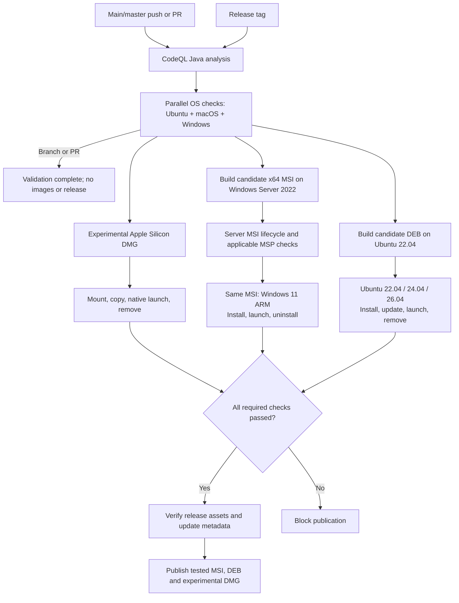

# Desktop releases

Each version retains two full installation assets:

- `OSCAR-UI-<version>-windows-x64.msi`: run the installer and launch
  OSCAR-UI from the Start menu.
- `oscar-ui_amd64.deb`: install with `sudo apt install ./<file>.deb`,
  then launch OSCAR-UI from the application menu.

Both include Java and Qt; the DEB also includes ICU and declares system display
library dependencies for APT. Windows includes app-local Visual C++ runtime DLLs.
GitHub adds its own **Source code (zip)** and **Source code (tar.gz)** links;
these are not application downloads and cannot be removed from the release UI.

Dependency source archives and their SHA-256 manifest are bundled inside each
application under `app/sources/` on Windows and
`/opt/oscar-ui/lib/app/sources/` on Ubuntu. This increases package size but
keeps extra source archives and checksum files out of the release asset list.
Keep bundled license files and the Java runtime's `legal/` directory intact.

### OpenJDK redistribution checks

Temurin is distributed under GPLv2 with the Classpath Exception. Preserve the
runtime's license, exception, copyright, and third-party notices, and distribute
its complete corresponding source, including build scripts. This project bundles
that source with the installer instead of relying on a written source offer.
There is no additional signed license form in this distribution approach.
See the [OpenJDK license](https://github.com/openjdk/jdk21u/blob/master/LICENSE).

`collect-release-sources.py` requires the pinned Temurin runtime version and
checks the JDK source archive against Adoptium's pinned SHA-256. Update that
checksum with the source URL and JDK pin when upgrading Java.
`verify-java-distribution.py` checks the extracted DEB, Windows application image,
and installed MSI payload before release upload. It verifies runtime/source
versions, GPL/Classpath text, module notices against the build JDK, source
checksum, and source/build-script presence. Identical shared notices are accepted
where DEB packaging omits duplicate per-module links. The check is distribution
QA, not a legal certification or a proof of reproducible JDK builds.

For an existing extracted package, run (paths shown for Ubuntu):

```bash
python3 scripts/build/verify-java-distribution.py \
  --runtime /path/to/extracted/opt/oscar-ui/lib/runtime \
  --sources /path/to/extracted/opt/oscar-ui/lib/app/sources \
  --jdk-home /path/to/matching-temurin-jdk
```

On Windows, use the installation's `runtime` and `app/sources` directories.
Omit `--jdk-home` only for a basic payload check; it skips comparison against the
original JDK notices and exact vendor/build identification.

The published v0.2.5 MSI and DEB were extracted and checked on Linux. Both contain
the GPL/Classpath text, corresponding JDK source/build files, and the source
archive matching Adoptium's SHA-256. Every distinct notice for the DEB's retained
modules also matches the original Temurin Linux JDK. Native Windows installation
and comparison with the Windows build JDK remain release-CI checks.


The MSI license dialog begins with the component summary from
`packaging/windows/install-information.txt`, followed by the unchanged project
license. Both release workflows use `packaging/release-notes.md` when creating
a new draft. Editing this template does not modify existing GitHub releases.
Keep these summaries aligned with the actual bundled components.

## Push the next release

Commit pending work first. From a clean checkout, the helper enables the
[pre-push hook](../testing/pre-push-checks.md) and runs local checks before version changes.
The hook checks the final release revision again before uploading. Missing
validators or failed checks block the push; CI still verifies both installers.

Run:

```bash
# Preview the default patch bump (0.1.0 -> 0.1.1).
tools/git/push-release.sh --dry-run

# Bump pom.xml, commit, create an annotated tag, and push.
tools/git/push-release.sh

# Alternatively choose a minor/major bump or explicit newer version.
tools/git/push-release.sh --push-patch  # default: 0.1.0 -> 0.1.1
tools/git/push-release.sh --push-minor  # 0.1.0 -> 0.2.0
tools/git/push-release.sh --push-major  # 0.1.0 -> 1.0.0
tools/git/push-release.sh --version 0.2.0
```

Run only the command for the release you intend. On Windows, the same helper is
available as `python tools/git/push-release.py` with the same options.

The helper checks the current branch against origin and rejects dirty trees,
detached HEAD, existing tags, and non-increasing versions. It changes only the
root application version in `pom.xml`; Oscar's dependency version stays separate.
It pushes the branch and tag atomically, without force. If a push fails, it
retains the local commit/tag and prints the exact retry command. Use that retry
instead of bumping again. Dry-run checks origin but does not edit, commit, tag,
or push. A failure after editing may leave local work to inspect; it never
resets or deletes user work.

For the original `v0.1.0` or an already prepared version, the Oscar-compatible
`tools/git/update-tag.sh --tag v0.1.0 --push` helper remains available. It does not
bump or commit; existing tags are never moved. Use a new version for new code.

## CI-gated platform workflows

Exactly two workflow files are maintained:

- `oscar-ui-ci.yml`: main/master pushes, pull requests and manual validation;
  CodeQL runs once, followed by parallel OS checks. Also reusable by release CI.
- `release.yml`: version tags only; invokes that same validation, then parallel
  Windows, Ubuntu and macOS image builds and installer tests, then publication.


- **Windows package jobs** in `release.yml` builds the MSI from the complete application image, then verifies
  silent install, Start menu/desktop shortcuts, uninstaller registration, native
  launch without developer tools on PATH, and silent uninstall.
- **Ubuntu package jobs** in `release.yml` builds on Ubuntu 22.04 and checks
  installation, X11 launch under Xvfb, and APT removal on Ubuntu 22.04, 24.04, and 26.04.
  Both platforms verify that a user configuration outside the installation
  directory survives removal. Installer logs are retained as CI artifacts.

`release.yml` handles version-tag pushes and manual runs selected on a tag.
It first calls `oscar-ui-ci.yml` for the exact tagged commit, running the full
Ubuntu 22.04, Ubuntu 24.04, Ubuntu 26.04, macOS 15, and Windows 11 ARM checks in parallel. All three image-build jobs declare
`needs: ci`: failed, cancelled or skipped CI prevents packaging and uploads.
A passing branch build or an older tag does not satisfy this gate.
Release publishing remains gated by the coordinator. Manual runs on branches
skip release jobs; choose the release tag when rerunning through Actions.

They upload only
their own application asset to the same draft release. Publishing steps serialize
per tag to avoid concurrent draft creation. Rerunning a platform job replaces
only that platform's asset. No local build is needed to release from CI.

After both platform workflows pass, the coordinator checks that the expected
Windows MSI and Ubuntu DEB assets are uploaded and nonempty, then automatically
publishes the release. A failed or skipped required job prevents publication;
any draft already created remains a draft. The push helper returns after pushing;
follow the Release workflow in GitHub Actions for the publication result.
Use `python3 tools/git/release-status.py` for the latest run or add `--tag TAG`
to select a release; see the [status helper](../../../tools/git/README.md#check-release-status).
The helper triggers this CI flow; it does not publish from the local machine.
Existing old release assets are not deleted by these workflows.

## Build locally

Use the [local installer wrapper](build-images.md) for `--linux`, `--windows`,
or host-only `--all`. The underlying platform commands are documented below.

Release packaging requires **Temurin 21.0.10+7**, Python, and the pinned Qt/Oscar
bootstrap dependencies. Source collection checks that the JDK matches the source
archive being distributed. Update the workflow JDK pins and
`scripts/build/collect-release-sources.py` together when changing Java versions.

Windows x64 also requires Visual Studio 2022 C++ build tools with the x64 CRT
redistributable directory, plus WiX 3.14.1 (`candle.exe` and `light.exe` on
PATH). CI configures WiX before packaging. From PowerShell:

```powershell
./scripts/windows/bootstrap-oscar.ps1
./scripts/windows/setup-qt.ps1
./scripts/windows/windows-release.ps1
```

On Ubuntu x64, run `./install.sh --development --check` and install the
reported missing packages, including `fakeroot` and `dpkg-dev`. Select the
pinned release JDK above, then run:

```bash
./scripts/unix/bootstrap-oscar.sh
./scripts/unix/setup-qt.sh
./scripts/unix/linux-release.sh
```

Outputs are in `dist/windows/release/` and `dist/linux/release/`. Move existing
`dist/windows/app-image`, `dist/windows/msi`, or `dist/linux/deb` output aside before rebuilding.
The Linux helper extracts and tests its DEB without installing system files.
The Windows MSI requires WiX 3; it wraps the prepared application image so
the app-local runtime DLLs remain included. Plain `desktop.sh`/`desktop.ps1 package` is a
lower-level command; use the release helper to include corresponding sources.

## Verification

Before publishing, test Windows on a clean PC without Java, Qt, or Visual Studio:
install into a path containing spaces, launch, open text/binary configurations,
edit/duplicate/delete TLVs, save, and reopen. Check themes and cancel/overwrite
prompts. CI's Windows host already has system runtimes, so its smoke test does
not establish clean-PC compatibility. Windows packages are currently unsigned.
Other Linux distributions, macOS desktop packaging, and ARM are not verified.

The source archives include upstream build instructions and notices. App-local
Microsoft DLLs remain subject to Visual Studio redistribution terms and need a
new application release when their runtime is updated.

## Application icons

The Windows MSI wizard uses `packaging/windows/dialog.bmp` (493 × 312)
for its welcome/completion background and `banner.bmp` (493 × 58) for its
header. Both are 24-bit RGB bitmaps composed from the existing light icon.
Keep the dialog's area to the right of pixel 164 white and the banner's left
area white so native installer text stays readable. Refresh these assets
along with the ICO when changing the logo; normal builds need no image tools.
The production `windows-installer.py` authors the MSI with stable component
identities and WiX UI bitmap variables; jpackage builds the application image. Check both graphics interactively
on Windows; silent CI installation does not validate wizard appearance.

The window and About dialog use the supplied light/dark square PNG icons from
`docs/images/`, bundled in the application JAR. Changing Appearance updates the
application icon. The supplied square light/dark files currently contain identical
artwork, so switching themes does not visibly change the icon. Desktop launchers use the fixed light variant: PNG for Ubuntu
and `oscar-ui.ico` for Windows. The ICO contains 16, 24, 32, 48, 64, 128, and
256 pixel sizes converted from `oscar-ui-light-icon.png`; regenerate it when
that source artwork changes. These assets are included in the normal packages,
not uploaded as additional release assets.

To regenerate the Windows icon on a development system with `python3-pil`:

```sh
python3 - <<'PY'
from PIL import Image
with Image.open("docs/images/oscar-ui-light-icon.png") as source:
    source.save("docs/images/oscar-ui.ico",
                sizes=[(size, size) for size in (16, 24, 32, 48, 64, 128, 256)])
PY
```

Run this from the repository root with the system Python that provides Pillow.
Normal builds use the committed ICO and do not run image conversion.

## Uninstall and upgrade behavior

Windows MSI installs machine-wide (administrator permission required) and registers
an uninstaller in Settings → Apps → Installed apps. The Start menu entry is
included; the installer offers a desktop shortcut. The stable upgrade UUID
`80186748-531f-4a39-a6da-f5c81a1f0730` identifies future versions of this product.
CI verifies fresh installation and removal; cross-version upgrades still need
validation with two released MSI versions. The old portable ZIP is not an MSI
installation and is not automatically removed.

Ubuntu removal uses `sudo apt remove oscar-ui`. CI checks that package-owned
files, including its desktop entry, are removed. Both uninstallers leave user
configuration files outside the installation directory intact. Do not store
personal files under Program Files or `/opt/oscar-ui`.

Only the MSI and DEB are uploaded as release assets. Windows installation tests
run only on disposable GitHub Actions runners; the local packaging script builds
and tests the image without installing the MSI on the developer's machine.

## Linux dock identity

Qt is initialized with the application name `OSCAR-UI` before any windows are
created. Its desktop-file ID is `oscar-ui-OSCAR-UI`, matching jpackage's generated
launcher filename. `packaging/linux/OSCAR-UI.desktop` adds
`StartupWMClass=OSCAR-UI` for X11 matching while retaining jpackage's substituted
launcher and icon paths. Ubuntu CI checks the installed entry's name and class;
the native smoke test checks the application's startup identity.

## DEB launcher registration

The DEB uses `packaging/linux/postinst` and `prerm` to copy
and remove its launcher at `/usr/share/applications/oscar-ui-OSCAR-UI.desktop`.
It does not invoke `xdg-desktop-menu`: minimal/headless Ubuntu systems may lack
its writable menu directories, which previously caused removal to fail with
exit status 3. The desktop entry retains its absolute installed icon path.
The installer uses separate `install -d` and `install -m` commands, supported
by GNU and BSD install, so isolated maintainer-script tests also run on macOS.
Removal errors are not suppressed; only the package's own launcher is removed.
CI checks that the registered launcher matches the bundled entry and disappears
after uninstall on Ubuntu 22.04, 24.04, and 26.04, while user configurations survive.

Already-built v0.2.0 packages retain the old removal script. Publish the fix
under a new patch tag after validation; rerunning v0.2.0 builds the old code.
For an affected headless machine, creating the directory expected by xdg-utils
allows the old package to be removed:

```bash
sudo install -d -m 755 /usr/share/desktop-directories
sudo apt-get remove oscar-ui
```

Release helpers skip a new version when HEAD already matches the published tag
for the current POM version. This check runs before local build/test validation.
A matching local-only tag blocks another bump; push that existing release first.
Changes already pushed to main can still be released if they follow the current
version tag. See [push checks](../testing/pre-push-checks.md).

## Windows native DLL layout

The release image keeps one copy of each staged Qt library beside `OSCAR-UI.exe`.
`windows-dll-layout.py` moves DLLs from `app/qt/lib` and changes the launcher's
`java.library.path` to `$APPDIR/..`. Qt plugins stay in `app/qt/plugins`; Java,
Visual C++ runtime DLLs, source archives, and notices remain bundled.
This keeps dependencies in the executable directory used by the
[Windows DLL search order](https://learn.microsoft.com/en-us/windows/win32/dlls/dynamic-link-library-search-order).
Developer runs still use their staged `target/app/qt/lib` directory.

The release script rejects unexpected launcher settings or destination
collisions before relocating files, then smoke-tests a relocated image without
developer tools on PATH. The MSI lifecycle check verifies the single-copy
layout after installation, launches from a separate working directory, and
checks removal of the root Qt DLLs during uninstall. These Windows CI checks
must pass before publishing; portable layout tests do not prove DLL loading.

## Windows package size measurements

The published v0.3.0 MSI download was 225,156,232 bytes (225.2 MB). Its MSI file
table totals 318,381,949 bytes (318.4 MB, about 303.6 MiB) of installed payload:

| Component | Approximate size (MB) |
| --- | ---: |
| Dependency source archives | 168.5 |
| Private Java runtime | 80.2 |
| Qt libraries and plugins under app/qt | 23.9 |
| Launcher, root native DLLs, and other files | 24.6 |
| Application dependency JARs | 21.2 |

The source archives include OpenJDK (114.8 MB), Qt (48.4 MB), and Qt Jambi
(5.2 MB). These are compressed archives stored inside the installed application,
not runtime sizes. Removing Java alone would not remove the other components.

Applying the single-copy DLL layout to the extracted v0.3.0 MSI reduced its file
payload to **296,436,193 bytes (296.4 MB, about 282.7 MiB)**, saving
**21,945,756 bytes (20.93 MiB)** including the small launcher configuration edit.
This validates the layout savings, not native Windows launch behavior or the
compressed size of the next MSI. Windows CI must validate the resulting package.

Use decimal MB (1,000,000 bytes) and binary MiB (1,048,576 bytes) explicitly.
Windows Installed apps reported 519 MB in the observed installation, while its
application folder matched the roughly 304 MiB file payload. The cause of that
estimate discrepancy has not been established; do not describe it as measured
runtime usage or assume it is caused by cached MSI files.

For each release, measure the final MSI asset and installed file tree separately.
Keep source archive sizes distinct from runtime and total installed sizes in
`packaging/release-notes.md`. Do not promise a fixed Windows displayed size.

The uploaded Ubuntu asset uses the stable name `oscar-ui_amd64.deb` so GitHub’s
`releases/latest/download/oscar-ui_amd64.deb` URL works without a tag lookup.
The DEB retains its version internally; only the release filename is stable.

### Ubuntu updater payload

The DEB bundles `scripts/unix/ubuntu-update.py` at
`/opt/oscar-ui/lib/app/ubuntu-update.py` and depends on python3, pkexec, and zenity.
The extraction check verifies helper content. The Ubuntu install matrix also
exercises a synthetic-version upgrade through its privileged install mode,
rejects a repeat update, smoke-launches, and preserves user configuration.
Interactive polkit authorization is a separate desktop check. Release assets
without a GitHub SHA-256 digest remain manually downloadable but cannot use the
in-app installer. The updater creates no extra release asset or APT repository.

### Ubuntu cross-version dependencies

JDK 21 jpackage uses `ldd`, which includes indirect build-host dependencies.
On Ubuntu 22.04, this adds `libpcre3` through system GLib, even though our
payload uses GLib rather than PCRE1 directly. Ubuntu 26.04 cannot satisfy that
obsolete dependency. `scripts/build/deb-dependencies.py` inspects every payload
ELF with `readelf` before removing only `libpcre3` from the generated DEB.
It refuses removal if any ELF directly needs `libpcre.so.*` or the GLib
package dependency (`libglib2.0-0` or `libglib2.0-0t64`) is missing.
Other dependencies and payload files remain
intact; the destination system's GLib package selects its own dependencies.
The normalized DEB replaces the original only after a successful rebuild.

This runs for local and CI DEB packaging, requires `readelf` from binutils
(also a dependency of dpkg-dev), and does not install anything on the host.
The three Ubuntu install/launch/remove jobs remain the compatibility gate.
Cleanup skips APT removal when the package was never registered with dpkg;
it still verifies removal and preserves unrelated user configurations.

### Ubuntu uninstall helper

The DEB also bundles `ubuntu-uninstall.py`; extraction compares it with the
tracked source. About starts it unprivileged and it invokes pkexec for APT only
after the UI exits. It uses the existing python3/pkexec/zenity dependencies.
The install matrix checks package removal; interactive authorization and About
handoff require the separate checks in the verification checklist.

## GitHub Actions runtime

Workflows use explicit Node.js 24 actions: checkout v5, setup-python v6,
setup-java v5, upload-artifact v6 and download-artifact v7. These run on
GitHub-hosted runners; self-hosted adoption would require runner 2.327.1 or newer.
Application Java and bundled runtime versions are independent of this change.

The existing named artifact uploads/downloads retain their names, destination
paths, retention settings and release gates. Download-by-ID changes do not
apply to these workflows. Upstream references:
[checkout](https://github.com/actions/checkout/tree/v5),
[setup-python](https://github.com/actions/setup-python/tree/v6),
[setup-java](https://github.com/actions/setup-java/tree/v5),
[upload-artifact](https://github.com/actions/upload-artifact/tree/v6),
[download-artifact](https://github.com/actions/download-artifact/tree/v7).

## Production Windows patches

Windows publishes `windows-update.json` and compact `windows-patch-inputs.zip`
alongside the full MSI; a compatible immediate-previous release also gets an MSP.
The shared coordinator validates these assets before publishing. End users use
the MSI or in-app updater; the ZIP is retained build input, not a portable app.
Java/Qt and source archives are not duplicated in the ZIP. Preserve earlier
baseline-family MSI/MSPs for mandatory chained repair tests.
See [Windows updates](../architecture/windows-updates.md) for compatibility,
first-baseline migration and native validation still required.

For packaging fixes, use the local native build helper before tagging. GitHub
image builds start only through the tagged release pipeline after CodeQL and
all OS checks pass; there is no independent package-workflow dispatch.

### Draft publication lookup

The final publication job lists authenticated releases, selects the exact tag,
and reads its assets by numeric release ID. The REST tag lookup returned 404 for
the v0.4.8 draft in run `39358420041`, despite successful installer uploads.
Require exactly one numeric ID and keep all installer/manifest gates before
changing `draft` to false. Shell regression tests simulate this draft-only case
and reject missing or ambiguous release identities without publishing.

## Release validation gate

The reusable OSCAR-UI CI workflow tests Java on Ubuntu 22.04, 24.04,
26.04, macOS 15, and Windows 11 ARM. Windows uses x64 Java and Python
under emulation to match the shipping x64 application.

After that CI passes, build candidate installers. The Windows Server 2022
builder retains its MSI and production MSP checks. A fresh Windows 11 ARM
runner downloads the exact candidate MSI and verifies installation, bundled
Java/license materials, shortcuts, native launch, uninstall, and preservation
of an external user configuration. It receives the build JDK version from the
builder rather than maintaining another dependency pin. Ubuntu installation,
update, launch, and removal checks run on all three supported Ubuntu versions.

All required jobs must succeed before the release becomes public. A candidate
installer must exist before it can be installed for testing; the tested bytes
are promoted without rebuilding. Intermediate CI artifacts and draft release
assets are not the final public release. Failure or cancellation blocks publication.



Windows 11 ARM provides x64 emulation coverage, not native Windows 11 x64
hardware coverage. The automated smoke test does not establish interactive
SmartScreen or UAC behavior. The separate experimental macOS package workflow
adds native DMG validation. See GitHub's [runner reference](https://docs.github.com/en/actions/reference/runners/github-hosted-runners).

### CodeQL before platform checks

CodeQL is the first job inside `oscar-ui-ci.yml`, before either OS test job starts,
including when release CI runs against a tag. It builds Java with the pinned
OSCAR dependency, analyzes it, and uploads results to GitHub code scanning.
A failed or cancelled analysis blocks OS tests and downstream release jobs.
Only the security job and its reusable-workflow callers receive
`security-events: write`; OS test jobs retain read-only permissions.

Successful analysis means the scan completed, not that it found no alerts.
Findings appear in GitHub Security; alert severity is not an automatic release
failure policy in this workflow. If GitHub default CodeQL setup is enabled,
disable that duplicate setup when enabling this advanced workflow.

## Experimental macOS DMG

The POM remains the sole release-version source. Java 21 `jpackage` rejects
a macOS app version whose first component is zero. Packaging therefore derives
`CFBundleVersion` by adding one to the release major version (`0.6.0` becomes
`1.6.0`; `1.0.0` becomes `2.0.0`). Before signing, the packager sets
`CFBundleShortVersionString` back to the actual POM version. The About dialog,
JAR and DMG names retain the actual release version; no second version is maintained.

The macOS job in `release.yml` builds on an Apple Silicon macOS 15 runner. The macOS Maven
profile supplies Qt Jambi's universal native framework JAR. The focused
`scripts/build/macos-release.py` reuses Java build/attribution staging, extracts
JNI frameworks, invokes Qt's `macdeployqt` for Qt frameworks and Cocoa plugins,
and bundles a private Java runtime with `jpackage`. `sips`/`iconutil` produce the
native icon from the existing PNG. Dependency sources and notices are retained.

The bundle is ad-hoc signed after deployment, verified with `codesign`, and
packed into a DMG with an Applications shortcut. No Apple credentials, Developer
ID signature, notarization, or automatic macOS updates are configured.

The installer test mounts the actual DMG, copies the app into a temporary
Applications directory, ejects the DMG, and runs the native Cocoa smoke test.
It hides the build Qt directory and clears Java/Qt/dynamic-library environment
overrides before launching the packaged app. It then removes only that temporary
app and checks preservation of a synthetic external configuration file.
This is not proof of interactive Gatekeeper approval on a downloaded package.

Release publication now waits for Windows, Ubuntu, and macOS package jobs.
The final publisher attaches the verified DMG before making the release public.
Manual release dispatch must select a version tag and follows the same gates.
Native DMG validation passed in run 39674156576; interactive Gatekeeper approval
on a downloaded package remains a separate user check.

Local Apple Silicon build (after OSCAR bootstrap and Java 21 setup):

```bash
bash scripts/macos/setup-qt.sh
python3 scripts/build/build-image.py --macos
```

Output: `dist/macos/release/OSCAR-UI-<version>-macos-arm64.dmg`.
`--all` selects macOS on Apple Silicon; Linux cannot cross-build this package.
