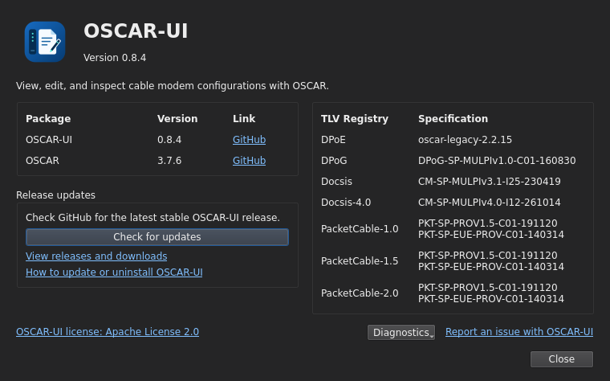

# About and updates

[User guide](README.md)

Choose **About → About OSCAR-UI** to see installed component versions in the
**Package | Version | Link** table. Project links open OSCAR-UI, OSCAR and Qt
Jambi on GitHub. The license link opens OSCAR-UI's license in its repository.
**Report an issue with OSCAR-UI** opens the project's GitHub issue form in your
browser.
**About → About Qt** displays the Qt information dialog.

Choose **About → Check for updates** for a manual online check against the latest
published stable OSCAR-UI release. Draft releases are not offered. The check does
not install updates automatically. Use the releases/downloads link to obtain the
installer for your platform and follow the [installation instructions](../../README.md#download).

**How to update or uninstall OSCAR-UI** opens the guide for your platform
(Windows or Ubuntu), including upgrade and removal instructions.

An unavailable network or failed update check does not mean the installed
version is current; retry when GitHub is reachable.

## Dark-mode screenshots

**About, package links, and release updates**



## Install an Ubuntu update

After **Check for updates** finds a newer verified Ubuntu release, click
**Update on Ubuntu**. Save or discard unsaved work, wait for the download and
verification, then choose **Close and install**. The app closes; Ubuntu requests
administrator approval. A separate progress window reports the result and offers
to reopen OSCAR-UI. Canceling before installation does not change the package.

This is available for installed Ubuntu x64 DEB packages. Development runs retain the release download link. See the
[Ubuntu update instructions](../install/ubuntu.md#update) for fallback and failures.

## Uninstall OSCAR-UI

Choose **About → About OSCAR-UI**. In a supported installed package, the
**Uninstall OSCAR-UI…** button is below **Release updates**, above **Close**.
Confirm, then save or discard unsaved changes; Cancel keeps the application open.
On Ubuntu the UI closes, administrator approval appears, and a separate progress
window reports removal. On Windows the UI closes and Installed apps opens;
select OSCAR-UI and choose Uninstall there.

Configuration files outside the installation directory remain. Ubuntu removal
does not purge or autoremove dependencies. If authorization is canceled, the
package remains installed and you can launch it again. A failed removal shows
the log path; use the platform installation guide to recover from APT errors.
The button is hidden when running from a development checkout with `desktop.sh`.
An older installed release will not gain the button until you install a package
that includes this feature. The uninstall-guide link remains available.

### Ubuntu terminal command

Close OSCAR-UI, then run:

```bash
sudo apt remove oscar-ui
```

Configuration files outside the installation directory remain. This also works
when your installed version does not have the uninstall button.

### Windows manual removal

Open **Settings → Apps → Installed apps → OSCAR-UI → Uninstall**.
See the [Windows installation guide](../install/windows.md) for more details.

## Upgrade indicator

When a newer stable release is available, a green **Upgrade** chip appears at
the upper-right of the main window's menu bar. Click it to open the update
dialog. Compatible installed packages offer their platform update action;
other installations retain the download link. Clicking the chip installs nothing.

OSCAR-UI makes one background GitHub release check at startup. The chip stays
hidden when up to date, running a newer development build, or offline.
**About → Check for updates** retries the check and refreshes the indicator.

## Install a Windows update

A compatible release enables **Update on Windows**. Save or discard changes,
confirm closing the app, then follow the download and administrator prompts.
The app restarts after success; a reboot requirement is reported separately.
Cancel or failure offers to reopen it.

This requires the new MSI baseline and the immediately previous compatible
release. If About requests a full MSI, install that baseline before trying later
patches. Changed dependencies or skipped versions also use the full installer.
See [Windows update instructions](../install/windows.md#update).
