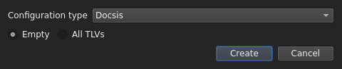
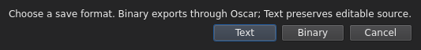

# Create, open and save files

[User guide](README.md)

## New

Choose **File → New** and select the configuration type and starting template.
The new draft opens in its own tab; existing files remain open.
An All TLVs template is a reference for available fields, not a ready-to-deploy
configuration. Enter values and remove unwanted entries before saving.

## Open

Choose **File → Open** and select a text or binary file to open in a new tab.
You can also right-click the tab row for Open or New. Contents determine the
format; changing the filename extension does not convert a file. OSCAR-UI selects
a compatible catalog automatically. Shared DOCSIS encodings do not uniquely
identify the modem's version; supported D4.0-only fields select the D4.0 catalog.

Text is compiled through OSCAR before display. A compile failure reports an
error and leaves the current document in place. Binary import must preserve TLV
payloads through its editable representation. Unknown, malformed or lossy inputs
are rejected. Input and decoded text are limited to 1 MiB.

Opening a binary does not require a shared secret. Opening alone is not a MIC
verification; use [Tools → Check Shared Secret](check-shared-secret.md).

## Work with several files

Open each file with **File → Open**, or right-click the tab row and choose
**Open**. Select a filename tab to show that file in both the TLV tree and text
preview. The lower-right **Text/Binary** label follows the selected tab.

Save applies to the selected tab. An italic tab title marks unsaved changes;
switching tabs preserves them. Opening the same file again selects its existing
tab. For navigation and closing shortcuts, see [Workspace](workspace.md#keyboard-shortcuts).

## Save and Save As

**File → Save** or **Ctrl+S** writes the current file in its existing format.
A new document asks for its first destination and defaults to Text.

**File → Save As → Text / Binary** chooses a new format and destination.
After saving, subsequent Save operations use that destination and format.
Binary output is generated by OSCAR and requires a shared secret where applicable.
The session key can be entered in [Settings → Secrets](settings.md#secrets).

Display masking does not replace real values in saved files. Binary saving
recalculates generated MICs. A successful compile is not full provisioning
validation. Encoding errors preserve the destination and unsaved document.

Save As confirms overwrites. Changes made externally are checked before replacing
files. Cross-format saves cannot overwrite the source in the other format;
choose another destination. Save As also refuses destinations already open in
another tab. New and Open preserve other tabs without discard prompts. Closing a
dirty tab offers Save/Discard/Cancel; Exit reviews every unsaved tab. Cancel or a
failed save aborts closing and leaves tabs open.

## Check Config and current limits

**File → Check Config** is an optional draft-check preview. It does not gate
binary saving. OSCAR nevertheless requires NetworkAccess, UpstreamServiceFlow
and DownstreamServiceFlow when compiling a DOCSIS binary. Include those settings
before exporting, or save an incomplete draft as text. Broader length and
dependency validation is unfinished. Some codecs remain read-only. Editable PacketCable binary import
with generated SNMP statements is not yet supported.

See [TLV editing](tlv-editing.md) and [configuration file security](../configuration-file-security.md).

## When a binary cannot open

If OSCAR cannot import a binary without losing TLV data, a **Binary import failed**
popup shows a read-only text diagnostic report. The current document and the
original file remain unchanged. **Copy report** copies the metadata listing;
**Close** dismisses it. No separate tool or menu is required.

The listing shows decimal byte offsets, dotted TLV paths, names, lengths, and
structural statuses, with indented child TLVs. It stops at the first structural
failure and identifies uninspected bytes. Unknown TLVs with complete framing
remain listed; their assumed one-byte lengths make subsequent boundaries conditional.
A scan reaching the end does not prove that values, MICs, or text round-trips are valid.

For automatic opens, the report explicitly uses a DOCSIS framing candidate;
this is not automatic family identification. Explicit DPoE opens use DPoE.
PacketCable and DOCSIS 4.0 envelope diagnostics are not supported by this API.
Payload values, raw hex, file paths, and upstream exception messages are omitted,
including when obfuscation is disabled. The metadata report remains available
when obfuscation is enabled. Text syntax errors and file-read errors retain their
normal error messages.

## Dark-mode screenshots

**Create a new configuration**

**Choose a save format**

## Repair invalid text

Text files are checked before import. Problems open a separate
[repair editor](text-repair.md) with live diagnostics and safe save choices.
