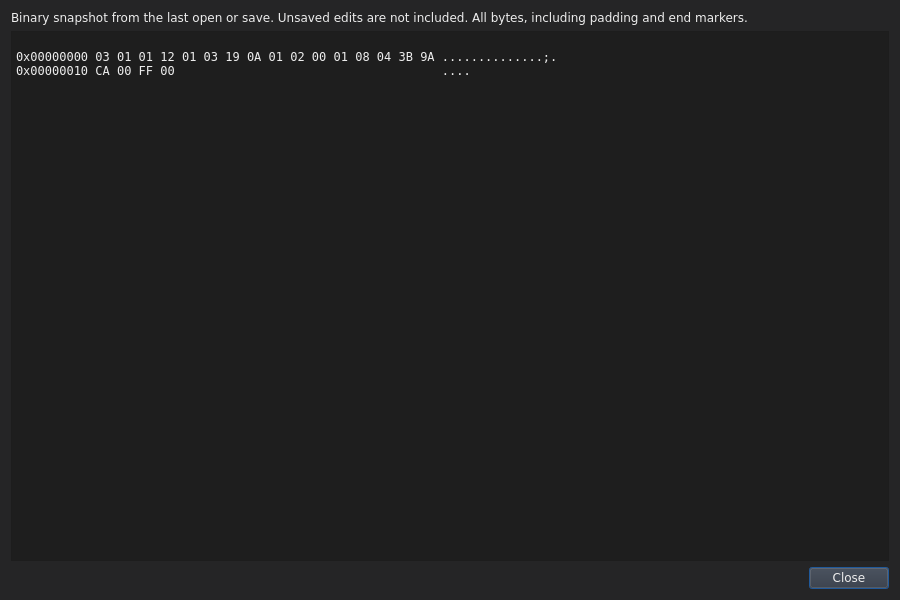
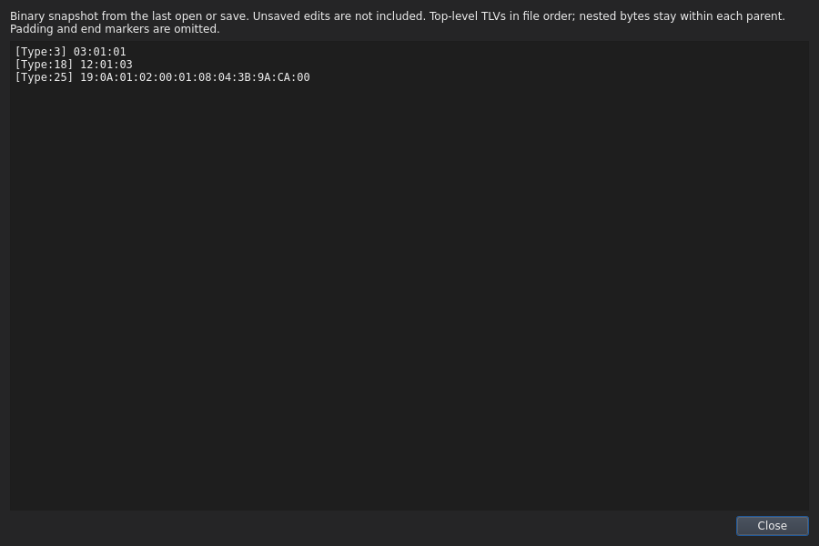
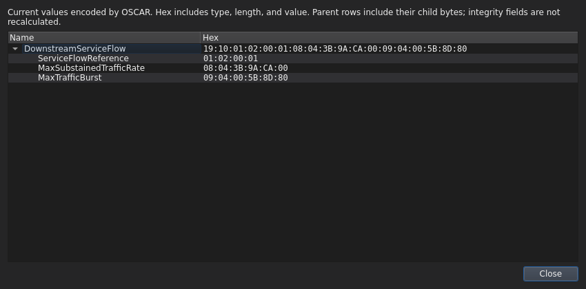
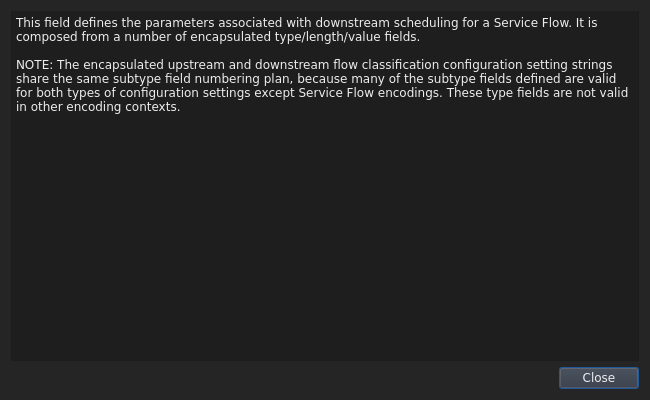

# Inspect binary data

[User guide](README.md)

## Whole-file inspection

Open a binary configuration, then choose:

- **Inspect → HexDump** for the original offset/hex/ASCII listing, after acknowledgment.
- **Inspect → TLV breakdown** for its decoded TLV structure.

Inspect is disabled when there is no open file or the current document is Text.
Hovering the menu explains that a binary file must be selected. These views use
the binary snapshot from the last open or save; unsaved edits are not included.

HexDump first asks you to acknowledge that community strings, passwords, and
other secrets may be visible in clear text. **Cancel** is the default and shows
no dump. **Yes** opens the original bytes, even when masking is enabled. This
acknowledgment is required each time and does not change your masking setting.

## Selected TLV hex

Select a TLV in the configuration tree and choose **View TLV Hex** from its
context menu. The popup shows **Name** and **Hex** columns. A Parent TLV includes
its nested children with indentation; a scalar entry shows that entry alone.
Double-click a name in this popup to view its description.

## Masked inspection

With **Settings → Secrets → Obfuscate SNMP secrets** enabled, protected hex
records and their containing parents display a fixed `FF FF FF FF` replacement.
Masked TLV breakdown omits original sensitive lengths, offsets and ASCII
columns. The output is a masked view, not the file's literal bytes.

Inspection does not check a shared secret or certify configuration validity.
For a key check, use [Tools → Check Shared Secret](check-shared-secret.md).

## Dark-mode screenshots

**Whole-file HexDump**

**Whole-file TLV breakdown**

**Selected parent TLV and child hex values**

**TLV description**

