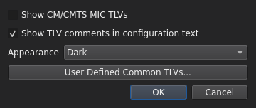
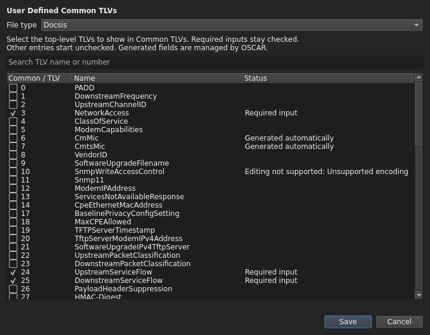
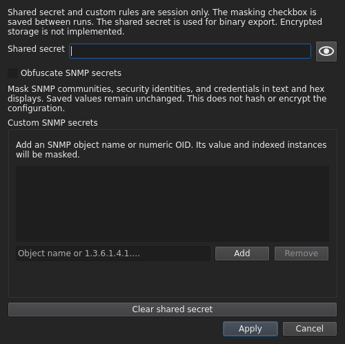

# Global settings and secrets

[User guide](README.md)

## Global

Open **Settings → Global** to choose:

| Option | Behavior |
| --- | --- |
| User Defined Common TLVs | Choose the top-level entries shown by the Add dialog for each file type. |
| Appearance: System / Light / Dark | System is the default and follows the desktop theme reported by Qt. |
| Show CM/CMTS MIC TLVs | Off by default; exposes generated, read-only MIC entries in the tree. |
| Show TLV comments in configuration text | On by default; shows OSCAR's TLV path comments beside statements. |

Choose **OK** to apply or **Cancel** to retain the previous choices. Appearance
is saved between runs in the application's settings JSON. MIC visibility and
TLV-comment visibility are session choices.

## User Defined Common TLVs

Open **Settings → Global → User Defined Common TLVs**.

1. Select a **File type**. The list shows every top-level TLV in its OSCAR registry.
2. Required user-entered settings start checked and cannot be unchecked.
   Other entries start unchecked; select the ones you want in **Common TLVs**.
3. Search by TLV number or name as needed. Switching file types retains your
   unsaved selections so you can configure several types at once.
4. Choose **Save** to apply all selections, or **Cancel** to discard them.

Save in this dialog is independent of the Global dialog's OK/Cancel buttons.
Your selections are saved per user, persist after restarting, and survive normal
application and OSCAR dependency updates. They do not change a configuration
file or the registry bundled with OSCAR.

DOCSIS and DPoG default to NetworkAccess and the upstream/downstream service
flows. No reviewed minimum list is supplied for DPoE or PacketCable, so those
Common views start empty until you select entries. Entries marked **Generated automatically** cannot
be selected here. Selecting a currently unsupported entry does not enable its
editor: Add still shows its restriction, and existing instance limits apply.

**All TLVs** in Add remains available regardless of your preferences. Nested
containers show all children in either view. After an update, newly introduced
optional TLVs appear in All and in this settings list; they are not automatically
added to your Common view. Newly required inputs are included automatically.

## Secrets

Open **Settings → Secrets** to enter the shared secret used for binary export.
The field is masked. Hold the eye button to reveal its value; releasing it or
interrupting the hold masks it again. **Apply** retains the key for the current
session only. **Clear shared secret**, followed by Apply, clears it. Cancel
retains the previous session values.

**Obfuscate SNMP secrets** masks recognized community strings, SNMPv3 credentials
and security identities in the text, tree, editors, clipboard preview copies and
hex views. Text uses `********`; protected hex uses `FF FF FF FF`. These fixed
replacements do not disclose the original secret length. The status shows
**Masked** when enabled. This checkbox persists between runs.

To recognize an additional SNMP secret, enter an OSCAR-resolvable name or numeric
OID under **Custom SNMP secrets**, click **Add**, then **Apply**. Indexed instances
are included. **Remove** deletes a rule. Custom rules are session-only.
Some indexed symbolic SNMP names remain unsupported; use numeric OIDs when
OSCAR cannot resolve a name.

The shared secret and custom rules are not persisted or encrypted. Original
values remain in saved files regardless of masking. Read
[Configuration file security concerns](../configuration-file-security.md).

The [shared-secret checker](check-shared-secret.md) has its own temporary key
field and does not change the export key in Settings.

## Dark-mode screenshots

**Global settings with Dark selected**

**Session secrets and masking settings**

