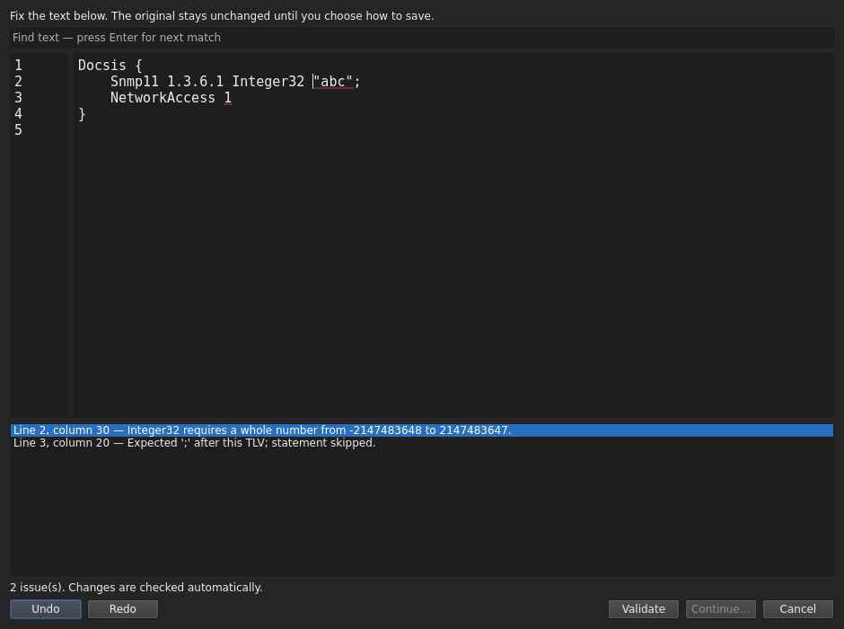
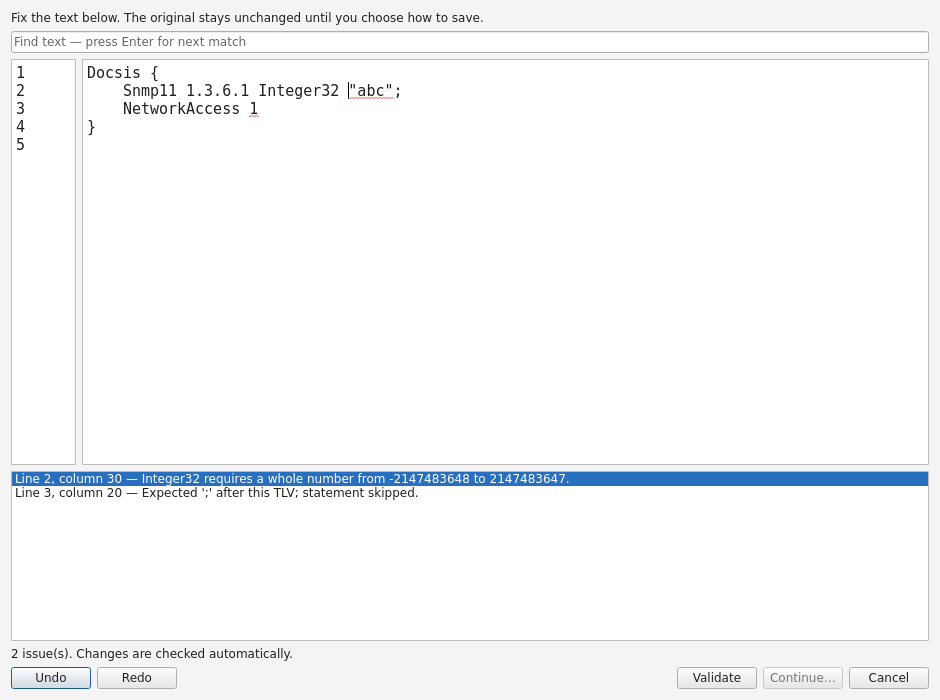
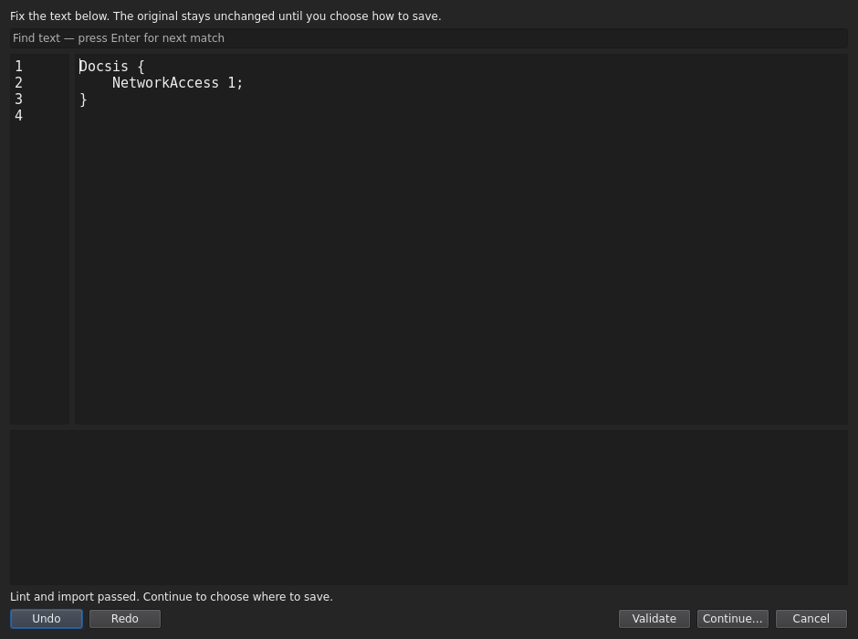
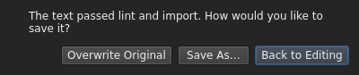

# Repair a text configuration

[User guide](README.md) · [Files](files.md)

When you open a text file, OSCAR-UI checks its syntax and SNMP value formats, then
tries the normal text import. If it finds a problem, **Repair Text File** opens
separately. Your current workspace and the original file remain unchanged.

## Fix the errors

- Edit the text beside the line numbers; Undo, Redo and Find are available.
- Red wavy underlines show reported locations. A missing character is marked
  beside its insertion point; the error list gives the exact line and column.
- Click an error to move to its location.
- Checking runs automatically after a short typing pause. **Validate** checks
  immediately. Continue stays disabled until the current text passes both lint
  and import checks.
- An import failure can appear without an underline when OSCAR provides no
  source location. Fix the reported name or value, then validate again.

The editor displays the original raw text, including any secrets in the file.
Workspace secret masking does not mask the repair editor.

## Save and open

Choose **Continue…**, then select how to save:

- **Overwrite Original** replaces the source only if it has not changed externally
  and is writable.
- **Save As…** preserves the source and saves a new file. Existing destinations
  require confirmation. Choose a different destination if it is already open in
  the workspace.
- **Back to Editing** returns without saving.

The saved file opens in a workspace tab only after saving succeeds. A save error
leaves your edited text available in the repair window; validate again and choose
another destination if needed. Cancel leaves the source unchanged and asks before
discarding modified text. When saved, text uses the editor's normalized line endings.

Passing lint and import is not proof of complete configuration validity or device
compatibility. Incomplete drafts can still be opened. Binary inputs use the normal
binary opening workflow and do not open this text repair editor.

Screenshots are captured from real Qt widgets on Linux with synthetic inputs;
window decorations differ on Windows and macOS.
