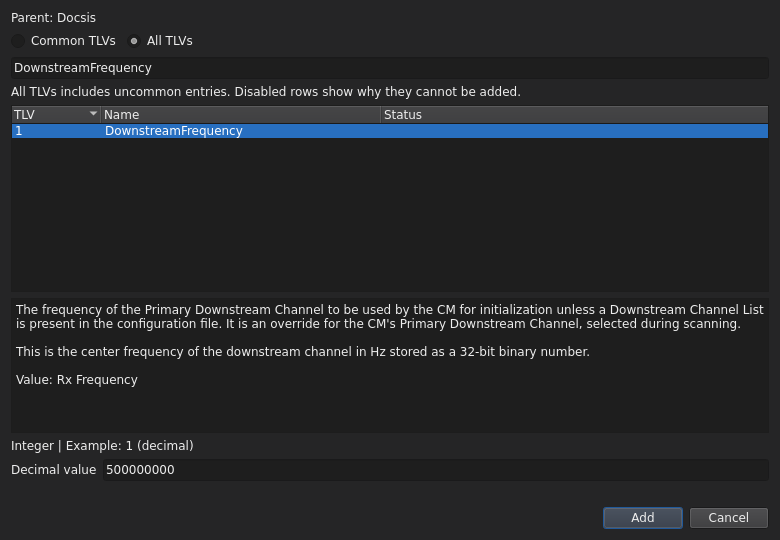
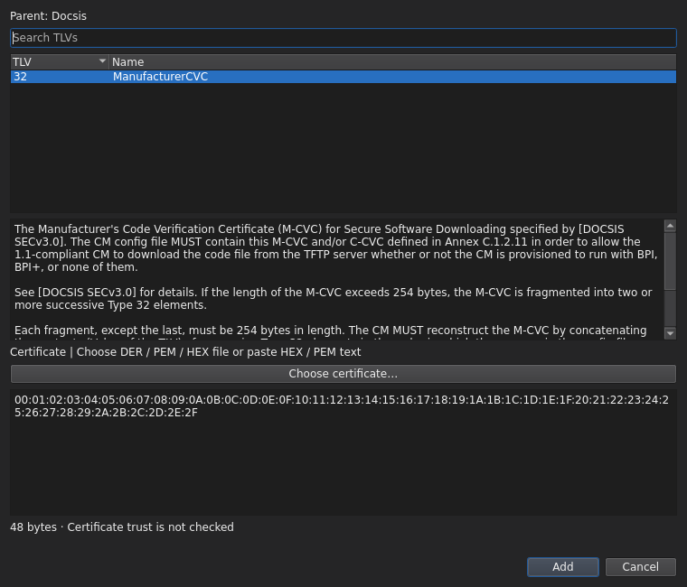
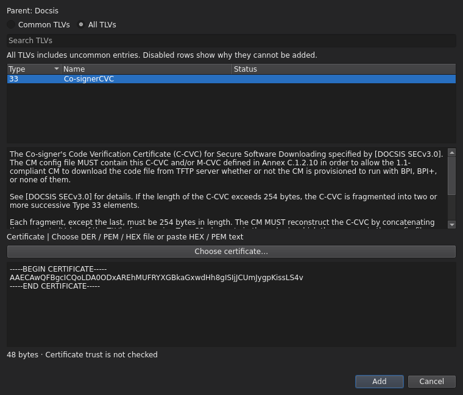
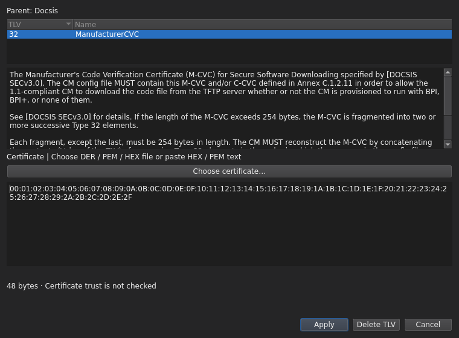
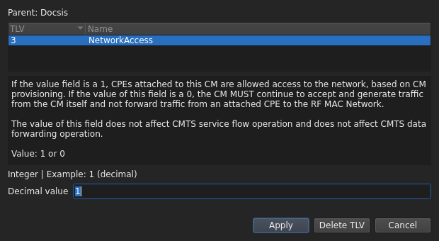
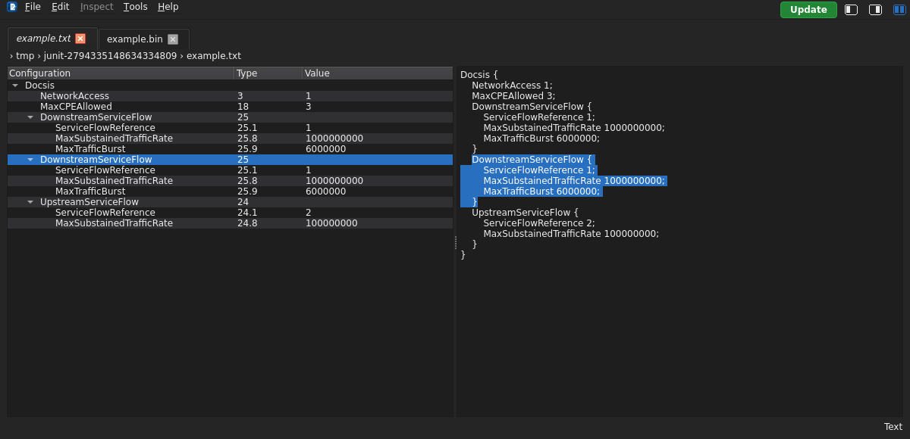
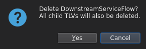
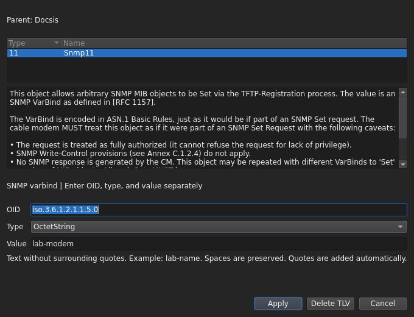

# Add, edit, duplicate and delete TLVs

[User guide](README.md)

## Embedded services

In DOCSIS configurations, add eRouter settings under **eRouterConfig** and
OpenCable settings under **eSTBConfig**. These are parent TLVs, not separate
file types. DOCSIS 4.0 exposes the supported eRouter settings only.

The ePS, eMTAConfig, eTEAConfig, eDVAConfig, and eSGConfig entries accept opaque
hexadecimal payloads in regular DOCSIS files. Enter payload bytes only, without
the outer type and length. OSCAR validates hex syntax and the 254-byte maximum;
it does not interpret the embedded service contents.

## Add

Select the parent or document root, then choose **Edit → Add TLV** or **Add TLV**
from the tree's right-click menu. Choose a view above Search:

- **Common TLVs** (default): your per-file-type selections from
  [Settings → Global → User Defined Common TLVs](settings.md#user-defined-common-tlvs).
  On first use, only required user-entered TLVs are included.
- **All TLVs**: every registry-defined entry for the selected parent, including
  uncommon and unavailable entries. Use this view when a TLV is missing from Common.

Both views support searching by name, dotted path, description and codec.
For child containers, both views show all defined children. The Common list is
a saved display preference; it does not change OSCAR's supported TLVs or rules.

The chooser has **TLV**, **Name**, and **Status** columns. Click TLV or Name to
sort by numeric path or name. Disabled rows show their restriction in Status
and a tooltip: instance limit reached, generated automatically, or editing not
supported. To change a singleton already present, select it in the main tree
and choose Edit. Even an empty reference-template placeholder counts as present.

Regular DOCSIS offers eRouter and eSTB; DOCSIS 4.0 offers eRouter only. All TLVs
shows registry-defined types, not arbitrary unknown numeric types.

Adding a Parent TLV creates its immediate children as blank placeholders.
Nested parents stay empty until explicitly populated. Placeholders are not
recommended values or deployment defaults. Delete unwanted children and enter
supported values before compiling.

Search the catalog and enter a value when adding a TLV.

## Manufacturer and co-signer certificates

At the document root, choose **Add TLV** and search for **ManufacturerCVC**
(TLV 32) or **Co-signerCVC** (TLV 33). Choose a certificate file or paste its
contents into the multiline input:

- **DER**: select a binary `.der`, `.cer` or `.crt` file.
- **PEM**: select a PEM file or paste one complete `BEGIN CERTIFICATE` /
  `END CERTIFICATE` block, including its delimiters.
- **HEX**: paste complete byte pairs, contiguous or separated by spaces,
  newlines or colons; `.hex` and `.txt` files are treated as HEX text.

### Choose a file or paste HEX

Use **Choose certificate…** to load a local certificate. To paste HEX instead,
enter the byte pairs directly in the multiline field. Add becomes available
when the input passes validation.

### Paste PEM text

Select **Co-signerCVC** for TLV 33, then paste the entire PEM block. PEM input
also works for ManufacturerCVC; both entries offer the same file and text options.

### Replace an existing certificate

Double-click the CVC row, choose another file or replace the pasted contents,
then select **Apply**. **Cancel** discards the replacement.

These screenshots use synthetic bytes to demonstrate the controls, not valid
certificates for deployment.

The input shows the decoded byte count. Invalid or empty input disables Add or
Apply. Double-click an existing CVC to replace it using the same controls.
Cancel leaves the document unchanged. File contents are embedded in the
configuration; the file path is not saved as a reference.

OSCAR handles encoding and certificate fragmentation. The tree shows one row
per certificate, the text panel contains its HEX value, and its hex popup includes
all encoded fragments. Both CVCs can be present together. Input validation does
not verify ASN.1 certificate structure, signatures, trust, or device acceptance.

## Edit

Double-click a scalar TLV, or select **Edit → Edit TLV**. The popup contains the
current value, its data type, and an example or range. Apply changes the selected
instance; Cancel leaves it unchanged. Child TLVs are edited in the same way.

Parent TLVs hold child entries rather than a scalar value. Some unsupported
codecs are read-only, and generated CM/CMTS MICs cannot be edited manually.
For a masked secret value, leave the replacement field blank to retain the
existing value, or enter a replacement. See [Settings](settings.md#secrets).

Edit the selected TLV value.

## Duplicate

Select a top-level TLV and choose **Edit → Duplicate TLV** or its context-menu
command. This inserts a copy, including its children, immediately after the
original and selects the copy. For a service flow, edit the copied identifiers
and rates as needed; duplicating does not automatically assign unique values.
Catalog instance limits and protected entries still apply.

The copied downstream service flow is selected, including its children.

## Delete

Choose **Edit → Del TLV**, the context-menu delete command, or **Delete TLV**
in the edit popup. Confirm the deletion. Deleting a Parent TLV also removes all
its descendants. Protected entries remain read-only.

Changes remain in the document until you [save](files.md#save-and-save-as).
Use [View TLV Hex](inspection.md#selected-tlv-hex) to inspect a selected entry.

Confirm removal of a parent TLV and all its children.

## SNMP fields

For **Snmp11** and PacketCable **Snmp64**, Add and Edit show the same three
fields:

| Field | Input |
| --- | --- |
| OID | Numeric OID or an OSCAR-resolvable name, including instance/index; for example `1.3.6.1.2.1.1.5.0` |
| Type | Choose from OSCAR's supported type list |
| Value | Enter the value without surrounding quotes; spaces in text are preserved |

The hint changes with Type: `IpAddress` expects an IPv4 address such as
`192.0.2.1`; `HexString` expects byte pairs such as `00:01:FF`; integer types
show their decimal range. Apply is enabled only after field checks and OSCAR
compilation succeed. OSCAR 3.2.0 lists Counter64 but cannot compile that type.

When an existing secret is masked, leave both OID and Value blank and keep
Type unchanged to retain it. To replace it, fill both fields. Cancel discards
changes.

Binary files display OSCAR-resolved SNMP names with their instance indexes in
both the tree and decoded text. Unresolved portions remain numeric; OSCAR may
return a partial name such as `iso.3.6...`. For text files, the source is
preserved and the tree shows OSCAR-resolved names.

PacketCable Snmp64 uses these same controls and validation. OSCAR 3.2.1 fixes
value export so projected IPv4 values retain their expected format. PacketCable
SNMP binary import remains unsupported; this fix does not remove that limit.

Edit the OID, Type, and Value separately using synthetic lab data.
