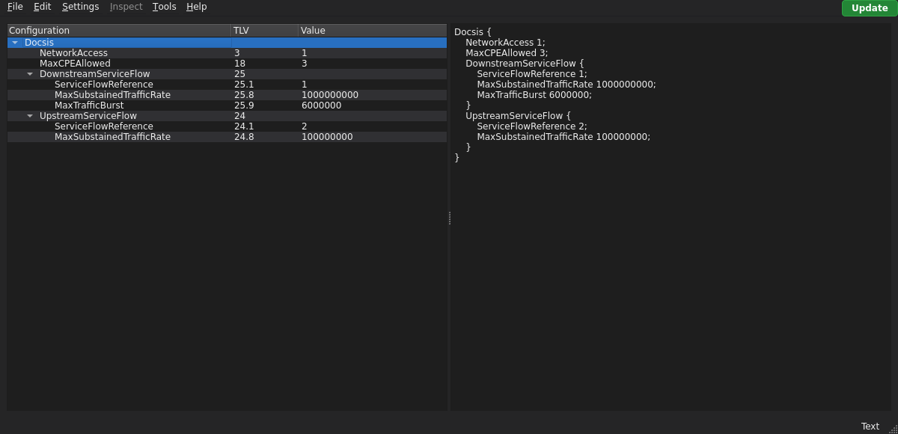

# Workspace

[User guide](README.md)

The main window contains a configuration tree and a read-only text preview.
Use the tree actions to change a configuration; the preview is not a text editor.

## Configuration tree

The **Configuration**, **TLV**, and **Value** columns show the name, dotted TLV
path, and current value. Expand a Parent TLV to see its children. For example,
`25.1` identifies a child of TLV `25`; repeated instances can share the same path.
Selecting an entry highlights its corresponding text. Selection alone does not
change the configuration.

The tree represents OSCAR's binary interpretation. Text inputs are compiled
through OSCAR before being displayed. Unsupported or lossy imports are rejected.

## Text preview and status

The text preview shows configuration statements. TLV comments can be shown with
**Settings → Global → Show TLV comments in configuration text**.

The bottom-right status identifies **Text** or **Binary**. With SNMP masking
enabled, **Masked** appears beside the type, separated by a vertical divider.
Masking changes the display, not the stored configuration values.

**Edit → Copy** copies selected preview text. **Select All** selects preview
text; neither command duplicates TLV objects. Use [Duplicate TLV](tlv-editing.md#duplicate)
for that operation. Copies of masked preview text retain the visible masking.

## Keyboard shortcuts

These are the standard Linux/Windows shortcuts; the menus reflect the platform.

| Action | Shortcut |
| --- | --- |
| New | Ctrl+N |
| Open | Ctrl+O |
| Save | Ctrl+S |
| Save As | Ctrl+Shift+S |
| Copy selected text | Ctrl+C |
| Select all preview text | Ctrl+A |

See [Files](files.md), [TLV editing](tlv-editing.md), and [Settings](settings.md).

## Dark-mode screenshots

**Workspace in dark mode**

A green **Update** chip appears at the upper-right of the menu bar when a
newer stable release is available. Select it for [update options](about.md#upgrade-indicator).
