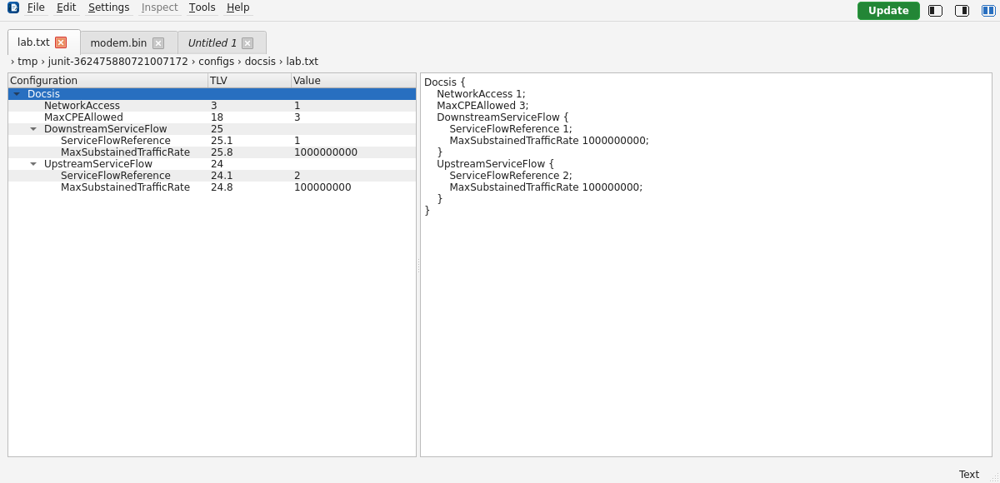
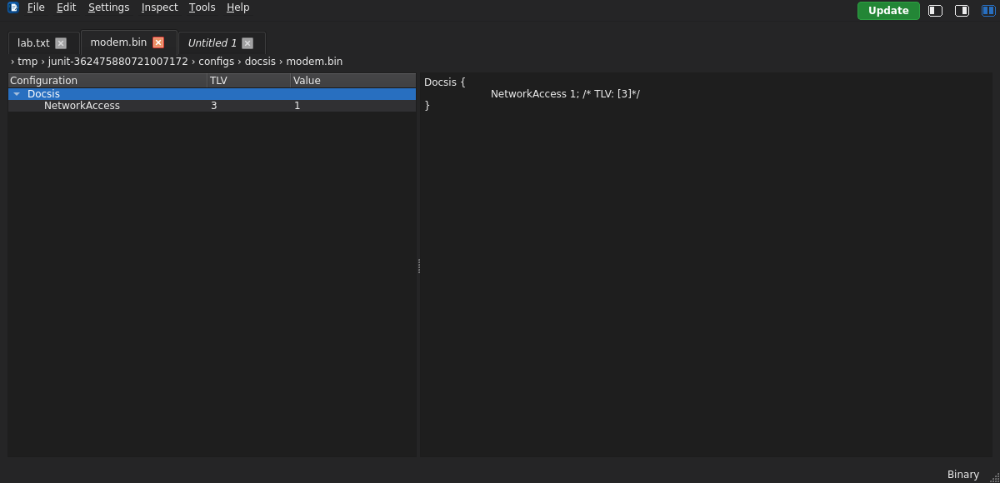

# Workspace

[User guide](README.md)

The main window contains a configuration tree and a read-only text preview.
Use the tree actions to change a configuration; the preview is not a text editor.
Windows, Linux and macOS use the same in-window menu and workspace control order.
The OSCAR-UI icon appears immediately before **File** on this row in both themes.
The title bar and minimize, maximize and close buttons follow your operating system.
The application and packaged launchers use the OSCAR-UI icon. macOS displays
the application icon in the Dock; its standard title bar does not show that icon.

The top-right row shows **Update** first when a newer release is available,
followed by **Tree only**, **Text only**, and **Both panels** layout buttons.
Hover over an icon for its label. Both panels are shown at startup; switching
back to both restores your previous split widths. Switching layouts preserves
the document and selection, and the text preview continues updating while hidden.
Layout buttons blend into the menu background in light and dark mode. The active
layout uses the theme's highlight color.

[View the workspace in light mode](../images/user-guide/workspace-light.png).

## File tabs and directory breadcrumbs

Tabs and breadcrumbs start at the left workspace edge above both panels.

Each New/Open adds a tab above the workspace panels. Select a tab to switch the shared
TLV tree, text preview, inspection actions, and bottom-right **Text/Binary** label.
An *italic* tab name means a new or modified document has not been saved; a
successful save restores normal lettering. Each file keeps its own tree selection,
expanded nodes, and scroll position.

The row below the tabs shows directory segments and the active filename. Long
paths shorten on the left; hover for the full path. Identical filenames in different
directories include enough parent context to distinguish their tabs. Opening the
same file again activates its existing tab, preserving unsaved edits.

Right-click a tab or blank space on the tab row for **Open** and **New**. These
use the same dialogs as the File menu. Tab controls remain accessible in tree-only
mode. Compare Files is not included in this version.

Use a tab's close button or **File → Close Tab** to close it. Unsaved tabs offer
Save / Discard / Cancel. Closing the last tab leaves an empty workspace. Exit,
application updates, and uninstall review all unsaved tabs before proceeding.
During a background operation you can select another tab; file-changing actions
and closing tabs wait until the serialized operation completes.

## Configuration tree

The **Configuration**, **TLV**, and **Value** columns show the name, dotted TLV
path, and current value. Expand a Parent TLV to see its children. For example,
`25.1` identifies a child of TLV `25`; repeated instances can share the same path.
Selecting an entry highlights its corresponding text. Selection alone does not
change the configuration.

The tree represents OSCAR's binary interpretation. Text inputs are compiled
through OSCAR before being displayed. Unsupported or lossy imports are rejected.

## Text preview and status

The text preview shows configuration statements. TLV comments can be shown with
**Settings → Global → Show TLV comments in configuration text**.

The bottom-right status identifies **Text** or **Binary**. With SNMP masking
enabled, **Masked** appears beside the type, separated by a vertical divider.
Masking changes the display, not the stored configuration values.

**Edit → Copy** copies selected preview text. **Select All** selects preview
text; neither command duplicates TLV objects. Use [Duplicate TLV](tlv-editing.md#duplicate)
for that operation. Copies of masked preview text retain the visible masking.

## Keyboard shortcuts

These are the standard Linux/Windows shortcuts; the menus reflect the platform.

| Action | Shortcut |
| --- | --- |
| New | Ctrl+N |
| Open | Ctrl+O |
| Save | Ctrl+S |
| Save As | Ctrl+Shift+S |
| Close tab | Ctrl+W |
| Next / previous tab | Ctrl+Tab / Ctrl+Shift+Tab |
| Copy selected text | Ctrl+C |
| Select all preview text | Ctrl+A |

See [Files](files.md), [TLV editing](tlv-editing.md), and [Settings](settings.md).

## Workspace screenshots

**Left-aligned tabs in dark mode**

A green **Update** chip appears at the upper-right of the menu bar when a
newer stable release is available. Select it for [update options](about.md#upgrade-indicator).

**Left-aligned tabs in light mode**

The tabs and path row span both panels in either theme. In these examples,
*Untitled 1* is an unsaved draft; the other two tabs are opened files.

**Binary tab selected: tree and status follow the active file**

